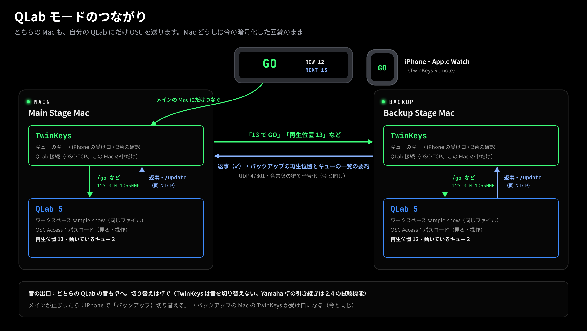
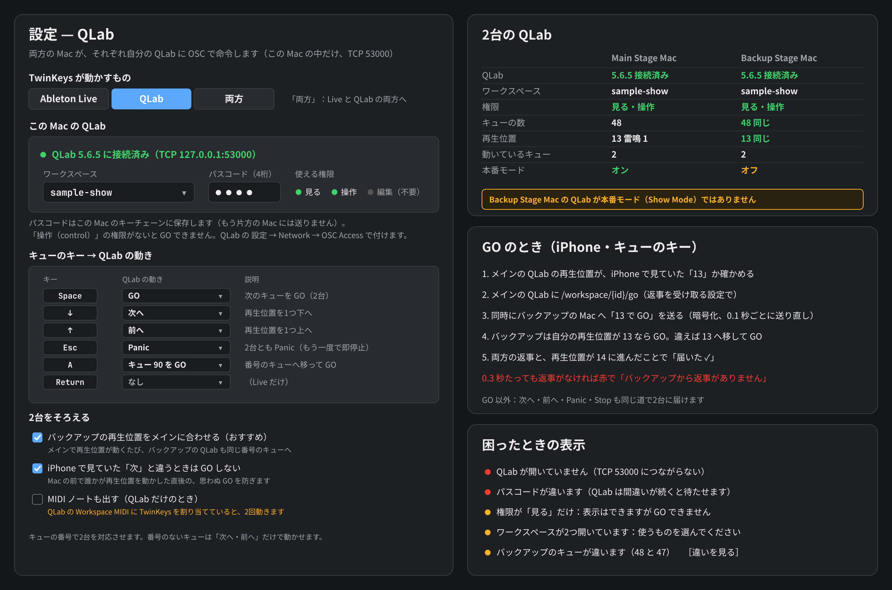
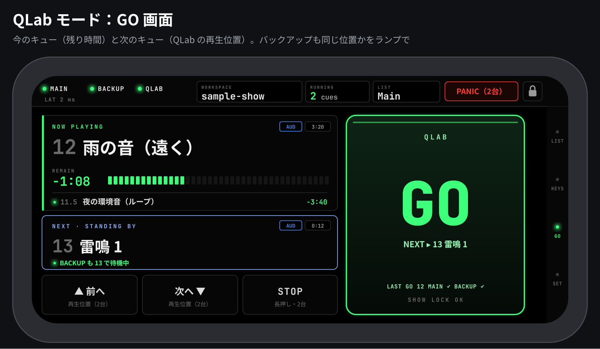
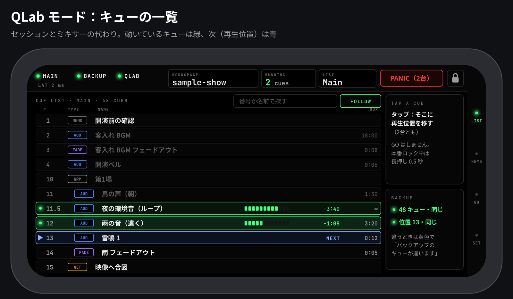
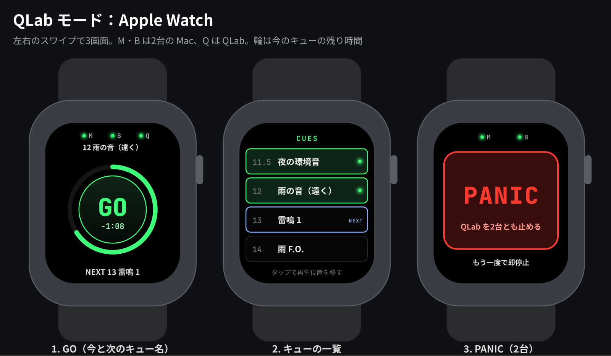

# TwinKeys 詳細設計書（案）：QLab モード

- 状態：**承認済み・フェーズ0〜2 を実装済み**（2026-11-14。13 章の8点はすべて案のとおり承認。3 は「メインの QLab につながっていないときは GO をバックアップにも送らない」）。実装と設計の違いは 15 章。本物の QLab・Mac・iPhone での確認はまだ（15.3）
- 調べた日：2026-11-13（QLab の版・機能はこの日の qlab.app の内容です）
- 対象（版番号は案）：TwinKeys（Mac）2.5.0 ＋ TwinKeys Remote（iPhone・iPad・Apple Watch）1.4
- 図：`docs/design/qlab-iphone-go.png`、`qlab-iphone-cuelist.png`、`qlab-watch.png`、`qlab-mac-settings.png`、`qlab-system.png`（絵の元：`design/qlab/make_qlab.py`）。キューの名前とワークスペースは架空です

この文書では、書いてあることを次の3つに分けます。

| 印 | 意味 |
|---|---|
| **【事実】** | qlab.app の公式ページか、このリポジトリのソースコードで確かめたこと。URL かファイル名を付けます |
| **【推測】** | 事実から考えたこと。外れることがあります |
| **【不明】** | 調べても分からなかったこと。本物の QLab で試すまで決められません |

---

## 0. まとめ（先に結論）

1. **しくみは Live と同じ形**にします。iPhone はメインの Mac にだけつなぎ、メインの TwinKeys が自分の QLab を動かし、同時に今の暗号化した回線でバックアップに送ります。バックアップの TwinKeys が自分の QLab を動かします。**どちらの TwinKeys も、自分の Mac の中の QLab にだけ OSC を送ります**（相手の Mac の QLab には直接送りません）。
2. **QLab とのつなぎ方**：OSC を **TCP（127.0.0.1:53000、SLIP の区切り）**で送ります。Swift と Apple 標準の Network.framework で書き、OSC の組み立て・読み取りは小さく自作して `TwinKeysCore` に置きます（Linux の CI でテストできる）。比べた結果は 2 章。
3. **2台をずらさない**：GO には「メインで待機していたキューの番号」を付けて送ります。バックアップの再生位置が違えば、その番号のキューに移してから GO します。再生位置が動くたび、バックアップの再生位置もメインに合わせます（切り替えでオフにできる）。
4. **Ableton はそのまま**。設定で「TwinKeys が動かすもの」を **Ableton Live／QLab／両方** から選びます。初期値は今と同じ Ableton Live。
5. **新しい通信**：Mac どうしは新しいパケット 0x23〜0x26、iPhone と Mac は新しいメッセージ `qlab…`。古い版は知らない種類を読み捨てるので、つながりは切れません（6 章）。
6. **段階**：フェーズ1＝キューのキーと iPhone の GO で2台の QLab を動かす。フェーズ2＝キュー名・状態・一覧を iPhone と Watch に出す。フェーズ3＝Windows（QLab は Mac だけのアプリなので、Windows 版は QLab を動かしません）。



---

## 1. 要件

### 1.1 やりたいこと（ご希望）

- Figure 53 の QLab でも、今の Live と同じように2台をまとめて操作したい。
- 例：iPhone で GO を押すと、2台の QLab が同時に GO する。今のキューと次のキューの名前が見える。
- Ableton（今の機能）はそのまま。QLab は追加のモード。

### 1.2 機能の要件

| # | 要件 | フェーズ |
|---|---|---|
| Q1 | 設定で、動かすものを Ableton Live／QLab／両方 から選べる | 1 |
| Q2 | 各 Mac の TwinKeys が、自分の Mac の QLab につなぐ（ワークスペースを選ぶ、4桁のパスコード） | 1 |
| Q3 | キューのキーに QLab の動きを割り当てる（GO、次へ、前へ、Panic、Stop、番号のキューを GO、なし） | 1 |
| Q4 | メインで押したキー・iPhone の GO が、メインとバックアップの両方の QLab に届く | 1 |
| Q5 | 届いたかの確認（今のキューと同じ：0.1 秒ごとに送り直し、0.3 秒で赤） | 1 |
| Q6 | 2台の再生位置をそろえる（GO に番号を付ける、再生位置をメインに合わせる） | 1 |
| Q7 | iPhone・Watch の GO と PANIC（2台）。本番ロック中も GO と PANIC は押せる | 1 |
| Q8 | iPhone・Watch に、今のキュー（名前・残り時間）と次のキュー（名前）を出す | 2 |
| Q9 | iPhone のキューの一覧（セッション・ミキサーの代わり）。タップで再生位置を移す | 2 |
| Q10 | 2台のキューの一覧を見比べ、違うときは黄色で出す（今の Live のセットの見比べと同じ考え方） | 2 |
| Q11 | 両方の QLab が本番モード（Show Mode）かを表示する | 2 |
| Q12 | Windows 版は QLab の通信を読み捨て、設定に「QLab は Mac だけ」と出す | 3 |

### 1.3 機能以外の要件

- 本番中の反応：キーを押してから両方の QLab に届くまで、今のキューと同じ程度（LAN で数 ms）【推測：QLab が OSC を受けてから動くまでの時間は測っていない】。
- Live だけ使う人には何も変わらない（初期値は「Ableton Live」。QLab の接続は動かさない）。
- 日本語と英語の画面。
- 開発者は Mac を持っていない前提で、テストは CI（GitHub Actions）と偽の QLab で行う（8 章）。

### 1.4 やらないこと

- QLab のキューの編集（名前・時間・ファイルの変更、キューの追加・削除）。だから「編集（edit）」の権限は使いません。
- QLab Collaboration（Mac どうしで1つのワークスペースを共同編集する QLab の機能）の代わりになること（3.3）。
- 音そのものの切り替え（今と同じく卓で行う）。
- 相手の Mac の QLab に直接 OSC を送ること（2.3 で理由）。

---

## 2. 技術選定

### 2.1 QLab と話す方法の候補（3つ）

| | A. OSC over TCP（おすすめ） | B. OSC over UDP | C. 今の MIDI ノートのまま（QLab の Workspace MIDI） |
|---|---|---|---|
| **中身** | Swift＋Network.framework で 127.0.0.1:53000 に TCP。OSC は SLIP で区切る | 127.0.0.1:53000 に UDP。返事は UDP 53001 | TwinKeys の仮想 MIDI ポートに出しているノートを、QLab の「Workspace MIDI」で GO などに割り当てる |
| **動作の軽さ** | 良い。つなぎっぱなし1本【推測】 | 良い | 一番軽い（今のまま） |
| **配布サイズ** | ほぼ増えない（OS の部品と自作の小さなコード） | 同じ | 増えない |
| **作りやすさ** | 中。SLIP（RFC 1055）と OSC の組み立てを書く。大きな返事（キューの一覧）も受けられる【事実】 | 中。ただし大きな返事は UDP に入らないことがある、61 秒何も送らないと切られる（`/forgetMeNot` が要る）、返事の受け口 53001 を別に持つ【事実】 | 作る物がない。ただしキュー名・再生位置・届いたかの確認は取れない |
| **対応 OS** | macOS（QLab が Mac だけ）。コードは Linux でもテスト可 | 同じ | 同じ |
| **将来性** | QLab 5 の公式の方法。TCP も UDP も「ほぼ同じに動く」と公式に書かれている【事実】 | 同じ | QLab の MIDI 制御も無料の機能【事実】。ただし状態を読む道がない |
| **AIでの書きやすさ** | 高い。小さなバイト列の組み立てで、テストデータで確かめやすい【推測】 | 高い | — |

出典：
- TCP と UDP、ポート 53000・53001・53535、SLIP：https://qlab.app/docs/v5/scripting/osc-dictionary-v5/ （「Getting Started」）
- 61 秒で切れる・`/forgetMeNot`・`/udpKeepAlive`：同じページの「Application Messages」（`/disconnect`、`/forgetMeNot`）
- 大きな返事は UDP に入らないことがある：同じページの `/workspace/{id}/cueLists` の注意書き
- Workspace MIDI（Note On などを GO・Panic に割り当てる、MSC）：https://qlab.app/docs/v5/fundamentals/workspace-settings/ （「Controls」→「The Workspace MIDI tab」）

**決定：A（OSC over TCP）。** 理由：
1. 返事（`/reply/...`）と変化の知らせ（`/update/...`）を同じ1本で受けられ、大きなキューの一覧も TCP なら受けられる【事実】。
2. TCP は QLab が勝手に切らない（「TCP is nice like that」）【事実】。つながっているかが TCP の状態で分かる。
3. 返事の受け口（UDP 53001）を TwinKeys が持たずに済む。同じ Mac で QLab Remote 以外の OSC 道具を使っていても、ポートを取り合わない【推測】。

**C は「今すぐ使える方法」として手順書に書きます（フェーズ0）。** TwinKeys は今でもキューのキーを両方の Mac の仮想 MIDI ポート「TwinKeys」にノートとして出しているので、両方の QLab の Workspace MIDI で同じノートを GO に割り当てれば、2台とも GO します【推測：QLab が TwinKeys の仮想ポートを MIDI 入力として選べるかは実機で確かめる】。ただし名前・再生位置・届いたかの確認はできず、再生位置がずれても気づけません。これが QLab モードを作る理由です。

### 2.2 OSC の部品：自作か、既存のライブラリか

| | 自作（おすすめ） | swift-osc（orchetect、MIT） |
|---|---|---|
| 中身 | OSC 1.0 の文字列・整数・小数・真偽の組み立てと読み取り、SLIP。数百行【推測】 | OSC の型・パターン一致・送受信。通信部分は SwiftNIO か CocoaAsyncSocket【事実】 |
| 配布サイズ | 増えない | SwiftNIO の分だけ増える【推測】 |
| テスト | `TwinKeysCore` で Linux でもテスト。Windows 版と同じテストデータを使える | 同じくできる |
| 外部への依存 | なし（今の TwinKeys と同じ方針：暗号以外は外部に頼らない） | 1つ増える |

出典：https://github.com/orchetect/swift-osc （README。最新版と最終更新日は、この作業の環境から GitHub の API が読めず【不明】）

**決定：自作。** QLab に使うのは OSC のごく一部（文字列と数の引数、JSON の文字列の返事）だけだからです。

### 2.3 バックアップの QLab に、メインから直接 OSC を送るか

| | X. 各 Mac が自分の QLab にだけ送る（おすすめ・今の Live と同じ） | Y. メインの TwinKeys が2台の QLab に直接 OSC を送る | Z. メインの QLab の Network キューでバックアップの QLab に送る（QLab だけで組む） |
|---|---|---|---|
| 暗号・なりすまし | Mac どうしは今の合言葉の暗号のまま。OSC は Mac の外に出ない | OSC は暗号化されない。4桁のパスコードがネットワークにそのまま流れる【推測：辞書に暗号の説明がない】 | Y と同じ |
| メインの TwinKeys が止まったとき | バックアップの TwinKeys はそのまま動く（iPhone を切り替えればすぐ使える） | バックアップの QLab を誰も動かさなくなる | メインの QLab が止まると、バックアップも止まる |
| 届いたかの確認 | 今のキューと同じ（返事・送り直し・赤） | 自分で作る | ない |
| ライセンス | 不要（OSC での遠隔操作は無料）【事実】 | 不要 | **Network キューは有料のライセンスが要る**【事実】 |

出典：ライセンスと機能の表 https://qlab.app/docs/v5/general/features/ （「Remote control via OSC, MIDI, MSC, iOS app」は Free でも ○、「Network cues」は Free では ×）

**決定：X。** バックアップの QLab は「メインの TwinKeys → 今の回線 → バックアップの TwinKeys → バックアップの QLab」の道で、メインと同じ命令を受けます（今の Live と同じ）。

### 2.4 使うもの

| 部品 | 版 | 状態 | 出典 |
|---|---|---|---|
| QLab | **5.6.5**（2026-10-28）。動く Mac：macOS 11 以降 | 今の最新版。QLab 6 の案内はダウンロードのページに見当たらない（QLab 6 があるかは【不明】） | https://qlab.app/download/ ・ https://qlab.app/docs/v5/general/change-log/ |
| Swift／Network.framework | 今の TwinKeys と同じ（Xcode 16 以降、CI は Xcode 26.6） | 安定 | README.md「Building from source」 |
| 偽の QLab（テスト用） | Python 3 の標準ライブラリだけ | 自作 | 8 章 |

QLab のライセンス：
- QLab 5 は無料で使え、追加の機能をライセンスで開ける【事実】（https://qlab.app/docs/v5/general/features/ ）。
- **TwinKeys に要る機能（OSC での遠隔操作、OSC Access のパスコード、状態の読み取り）は無料版で使えます**【事実：同じ表の「Remote control via OSC, MIDI, MSC, iOS app」が Free で ○】。
- 「Show control broadcast（`/listen`）」も無料版で使える【事実：同じ表】。
- 有料なのは Network キュー・MIDI キューなど（2.3 の Z の方法）【事実】。値段は https://qlab.app/shop/ にあるが、この設計では使わないので比べていない。

---

## 3. QLab について調べたこと（一次情報）

### 3.1 OSC 辞書から（https://qlab.app/docs/v5/scripting/osc-dictionary-v5/ 全体を読みました）

**つなぐ**

| 項目 | 内容 | 区分 |
|---|---|---|
| ポート | QLab は OSC を TCP と UDP の **53000** で受ける。ワークスペースごとに別のポートにもできるが、QLab 自体は 53000 で受け続ける | 事実 |
| 返事（UDP） | UDP で送ると、返事は **53001** に来る（`/udpReplyPort` で変えられる） | 事実 |
| 文字のまま | UDP **53535** で文字（例 `/cue/selected/start`）を受けて OSC として読む。返事はない | 事実（設定のページ https://qlab.app/docs/v5/fundamentals/workspace-settings/ にも同じ説明） |
| TCP の区切り | OSC 1.1 のとおり、SLIP（RFC 1055、両端に区切り）で区切る | 事実 |
| 接続 | `/workspace/{id}/connect {passcode}`。返事は `ok`（合う）・`badpass`（合わない）・`error`（ワークスペースがない）。間違いが続くと、次の `/connect` を受けるまで待たせる時間が伸びる | 事実 |
| パスコードなし | パスコードを送らないと「No Passcode」の行の権限でつながる。初期値は3つともオフなので、パスコードなしではつなげない | 事実（設定のページ） |
| パスコードの形 | **4桁の数字**。新しいワークスペースには、全部の権限を持つパスコードが1つ自動で作られる。いくつでも足せる | 事実（設定のページ「The OSC Access tab」） |
| 権限 | **view**（見る）・**edit**（キューと設定を変える）・**control**（再生位置を動かす、キューを始める・止める） | 事実 |
| 全部のワークスペースにパスコードがあるとき | どれか1つにパスコードでつなぐまで、アプリ全体の命令も受けない。`/version` と `/workspaces` だけは例外 | 事実 |
| UDP の切断 | UDP は 61 秒何も来ないと切られる（`/thump` などで保つ、または `/forgetMeNot 1`）。TCP は切られない | 事実 |
| 宛先 | `/workspace/{id}/...` の `{id}` は uniqueID か名前（名前は空白・日本語などがないときだけ）。**`/workspace/{id}` を付けないと、そのポートで受けている全部のワークスペースに届く**（QLab 4 との違い） | 事実 |

**動かす（権限の欄は辞書の表のとおり）**

| 命令 | 意味 | 要る権限 |
|---|---|---|
| `/workspace/{id}/go` | 今のキューリストを GO（待機中のキュー） | control |
| `/workspace/{id}/go "{番号}"`、`/workspace/{id}/go/{番号}` | その番号のキューに再生位置を移して GO（番号は文字列で送る） | control |
| `/cue/{番号}/go`、`/cue_id/{id}/go` | そのキューに再生位置を移して GO | control |
| `/workspace/{id}/panic` | 短いフェードで止める。フェード中にもう一度送るとすぐ止まる | control |
| `/workspace/{id}/panicInTime {秒}` | 指定の秒数で Panic | control |
| `/workspace/{id}/hardStop` | すぐ止め、リバーブなどの余韻も切る | control |
| `/workspace/{id}/stop` | 止めるが、余韻は残す | **edit**（辞書の表では view ×・edit ○・control ×）。※ 書き間違いかもしれない【推測】。実機で確かめるまで TwinKeys の「Stop」は `hardStop` を使う |
| `/workspace/{id}/pause`・`resume` | 全部を一時停止・再開 | control |
| `/workspace/{id}/playhead/next`・`/previous` | 再生位置を1つ下・上へ | control |
| `/workspace/{id}/playhead/{番号}`、`/playheadID/{id}` | 再生位置をそのキューへ（GO はしない） | control |
| `/workspace/{id}/reset` | 全部止めて、再生位置を先頭へ（TwinKeys では使わない） | control |
| `/workspace/{id}/doubleGoWindowRemaining` | 「二度押しよけ」が効いているとき、次の GO まであと何秒か | 読むだけ（view） |

**読む**

| 命令 | 返るもの | 権限 |
|---|---|---|
| `/workspaces` | 開いているワークスペースの一覧（uniqueID、displayName、port、udpReplyPort、version） | パスコードなしでも可 |
| `/version` | QLab の版 | パスコードなしでも可 |
| `/workspace/{id}/cueLists` | 全キューリストとキュー（uniqueID、number、name、listName、type、colorName、flagged、armed、グループの中は `cues`）。大きいので TCP で | view |
| `/workspace/{id}/runningCues`、`runningOrPausedCues`（`/shallow`、`/uniqueIDs` 付きで小さくできる） | 動いている（一時停止を含む）キュー | view |
| `/cue/playhead/...`（`/cue/playbackPosition` も同じ） | 待機中のキューに対する命令（例 `/cue/playhead/displayName`） | view |
| `/cue/{番号}/playhead`、`playheadID`（キューリストに対して） | そのリストの待機中のキューの番号・ID。なければ `none` | view |
| `/cue/{番号}/name`、`number`、`displayName`、`type`、`uniqueID`、`listName` | 名前・番号など | view |
| `/cue/{番号}/duration`、`currentDuration` | 長さ（秒） | view |
| `/cue/{番号}/actionElapsed`、`percentActionElapsed` | 経った時間（秒・割合） | view |
| `/cue/{番号}/isRunning`、`isPaused`、`isBroken`、`isLoaded` | 状態 | view |
| `/cue/{番号}/valuesForKeys "[\"name\",...]"` | 好きな項目をまとめて1回で | view |
| `/workspace/{id}/showMode` | 本番モード（Show Mode）か | view |

- **残り時間を直接返す命令は辞書にない**。残り時間は `currentDuration − actionElapsed` で計算する【推測：プリウェイトの扱いは実機で確かめる】。
- **数は辞書の「秒」**。`actionElapsed` は「elapsed action (in seconds)」【事実】。

**知らせを受ける**

| 命令 | 内容 | 区分 |
|---|---|---|
| `/updates 1`（`0` でやめる） | 変化があると QLab から届く。どの権限でも使える | 事実 |
| `/update/workspace/{ws}` | キューリストを読み直してほしい（ほかの変化でも届く） | 事実 |
| `/update/workspace/{ws}/cue_id/{id}` | そのキューを読み直してほしい | 事実 |
| `/update/workspace/{ws}/cueList/{list}/playbackPosition {id}` | 再生位置がそのキューに動いた（なければ引数なし） | 事実 |
| `/update/workspace/{ws}/disconnect` | ワークスペースが閉じるので切ってほしい | 事実 |
| `/listen`、`/listen/go`、`/listen/playhead` など（QLab 5.3 から） | 「Show control broadcast」。GO・再生位置の移動・Panic などが起きると `/qlab/event/workspace/go "{番号}" "{名前}" "{uniqueID}" "{種類}"` などが届く。**JSON ではなく普通の OSC** | 事実（https://qlab.app/docs/v5/networking/show-control-broadcast/ も） |
| Show control broadcast の入り切り | 「ワークスペースごとに入り切りできる」と書かれている。`/listen` だけで届くのか、設定を入れる必要があるのかは書かれていない | **不明** |

**返事の形**

```
/reply/{送った命令の住所} "{JSON の文字列}"
{ "workspace_id": "...", "address": "/送った/命令", "status": "ok" | "error" | "denied", "data": ... }
```

- `denied`：まだつないでいない、または権限が足りない【事実】。
- `/go` や `/panic` は**ふつうは返事をしない**。`/alwaysReply 1` を送ると、全部の命令に `status` 付きの返事をする【事実】。TwinKeys はつないだら `/alwaysReply 1` を送り、GO などの「届いた」を QLab の返事で確かめます。
- `/replyFormat` で返事の形を変えられる（TwinKeys は変えない）【事実】。

**注意**

- OSC の住所に**空白・日本語・絵文字は使えない**。キューの番号に空白や日本語があると、番号では呼べない【事実】（https://qlab.app/docs/v5/networking/using-osc/ ）。→ TwinKeys は番号を「2台を対応させる名札」として使い、実際に送るときは自分の QLab の uniqueID（`/cue_id/{id}/...`）で呼びます。
- 数の小数点は「.」だけ（地域の設定が「,」でも）【事実：同じページ】。
- Esc を1回押すと Panic、2回で Hard Stop は QLab の決まり【事実】（workspace-settings の「The Keyboard tab」）。

### 3.2 QLab 自身の通信の機能と、TwinKeys との関係

| QLab の機能 | 何ができるか | 2台の本番で足りないところ | 出典 |
|---|---|---|---|
| **QLab Remote**（iPhone・iPad） | ワークスペースの表示・GO・再生位置・編集。無料は読むだけ。キューを動かすには App 内課金「Show Control & Editing」。iOS 15 以降。Bonjour で見つける。QLab 5 とは暗号化して話す | 1つのワークスペース（1台の Mac）につなぐ。**2台を同時には動かせない**【推測：説明に2台同時の話がない】。Apple Watch の説明はない | https://qlab.app/docs/v5/networking/qlab-remote/ |
| **Collaboration**（Mac どうしの共同作業） | 1つの「Primary」のワークスペースを、ほかの Mac から見る・編集する・動かす | **キューはいつも Primary で動く**【事実】。だからバックアップの Mac で音は出ない。2台目の予備にはならない | https://qlab.app/docs/v5/networking/collaboration/ |
| **Network キュー** | QLab から OSC などを送る（例：メインの QLab から、バックアップの QLab に GO を送る） | 有料のライセンスが要る【事実】。メインの QLab が止まると届かない。届いたかの確認がない | https://qlab.app/docs/v5/networking/network-cues/ ・ features |
| **Workspace MIDI／MSC** | MIDI のノートや MSC で GO・Panic など | 状態が読めない（2.1 の C） | workspace-settings |
| **Show control broadcast** | GO や再生位置の動きを外へ知らせる | 知らせるだけ。2台をそろえる働きはない | show-control-broadcast |

**TwinKeys が足せるもの（正直に）**

- **2台に同時に届く**：1回の GO・キーで、メインとバックアップの両方の QLab が動く。QLab だけでやるには、Network キュー（有料）か、2つのリモートを別々に押すしかない。
- **届いたかの確認**：バックアップの QLab が本当に受けた（QLab の返事）ことを、メインの Mac と iPhone で ✓／赤で見られる。
- **2台の再生位置のずれに気づき、直す**：GO に番号を付け、バックアップの再生位置をメインに合わせる。違うキュー一覧を黄色で知らせる。
- **メインが止まったとき**：iPhone から「バックアップに切り替える」（今の機能）。バックアップの TwinKeys がそのまま受け口になる。
- **Apple Watch**：手首で GO・Panic・次のキュー名。
- **本番ロック**：iPhone のロック中も GO と Panic だけは押せる（今と同じ考え方）。QLab の「Show Mode」かどうかも2台分を表示する。
- **Live と QLab を同じキーで**：「両方」にすると、1つのキーで Live のクリップと QLab のキューを2台ずつ動かせる。

**TwinKeys がしないこと（QLab のほうが良いところ）**：キューの編集、ライトのキーパッド、ビデオのステージ編集、1台の QLab を細かく遠隔操作すること。これらは QLab Remote を使ってください（TwinKeys と同時に使えるかは【不明】。8.3 で確かめる）。

### 3.3 バックアップの QLab をどう追いかけるか

- **命令の道**：バックアップの QLab は、メインの TwinKeys から今の回線で届いた命令を、バックアップの TwinKeys が受けて動かす（2.3 の X）。Live と同じ。
- **2台を同じにしておく前提**：両方の Mac で**同じワークスペースのファイル**（同じキュー、同じ番号）を開く。Live で「同じセット」を前提にしているのと同じ。
- **番号で対応させる**：2台のキューは「キューの番号」で対応させる。uniqueID はファイルをコピーしても同じかもしれないが【不明】、番号はユーザーが見て直せるので番号を使う。
- **再生位置をそろえる**（5 章に詳しく）：
  1. GO は「メインで待機していた番号 N で GO」として送る。バックアップは自分の待機が N ならそのまま GO、違えば N のキューで GO（`/cue_id/{自分の uniqueID}/go`）して「直しました」と返す。
  2. メインで再生位置が動くたび（GO のあと、次へ・前へ、Mac の前での操作）、メインはその番号をバックアップに知らせ、バックアップは自分の再生位置を同じ番号に移す（設定でオフにできる。初期値オン）。
  3. 自動で続くキュー（auto-continue／auto-follow）は、両方の QLab が同じファイルなので同じように進む【推測】。進み終わるまで 0.5 秒は 2 の合わせを待つ（追いかけ合いを防ぐ）。

---

## 4. 画面構成

### 4.1 Mac：設定に「QLab」のタブを足す



※ Mac の画面は今の Mac 版の見た目（暗い灰色、青いボタン）に合わせました。A1「緑のランプ」は iPhone・Watch の見た目なので、Mac では「接続済み」の緑だけに使います。

| 場所 | 内容 |
|---|---|
| TwinKeys が動かすもの | **Ableton Live／QLab／両方**（初期値 Ableton Live）。両方の Mac で同じにする（違うと黄色） |
| この Mac の QLab | 状態のランプと文（「QLab 5.6.5 に接続済み（TCP 127.0.0.1:53000）」）。ワークスペース（開いているものから選ぶ。1つだけなら自動）。パスコード（4桁、●で隠す、この Mac のキーチェーンに保存、相手の Mac には送らない）。使える権限（見る・操作・編集）の表示 |
| キューのキー → QLab の動き | キーごとに：GO／次へ／前へ／Panic／Stop／番号のキューを GO／なし。初期値は Space＝GO、↓＝次へ、↑＝前へ、Esc＝Panic、ほかは「なし」 |
| 2台をそろえる | 「バックアップの再生位置をメインに合わせる」（初期値オン）、「iPhone で見ていた『次』と違うときは GO しない」（初期値オン）、「MIDI ノートも出す（QLab だけのとき）」（初期値オフ。QLab の Workspace MIDI に TwinKeys を割り当てていると2回動くと注意） |
| 2台の QLab（右） | 2台それぞれの：QLab の版と接続、ワークスペース、権限、キューの数（一致）、再生位置（一致）、動いているキューの数、本番モード |

**メインの Mac の画面（キューの欄）**：「直前のキュー」に「GO 12 雨の音（遠く）・BACKUP ✓」のように、QLab の番号と名前を出す。「つながり」の行に「QLab ✓」「バックアップの QLab ✓」を足す。

### 4.2 iPhone：QLab モードで変わる画面



| 画面 | Live のとき（今） | QLab のとき | 両方のとき |
|---|---|---|---|
| 上の帯 | MAIN・BACKUP・LIVE のランプ、再生・停止、TEMPO、POSITION、全ノートオフ | MAIN・BACKUP・**QLAB** のランプ、WORKSPACE、RUNNING（動いているキューの数）、LIST（キューリスト名）、**PANIC（2台）** | Live と同じ帯に QLAB のランプを足す。赤いボタンは「全ノートオフ＋PANIC」 |
| GO | NOW PLAYING（シーン）、NEXT（選んでいるシーン）、前へ・次へ | NOW PLAYING＝動いているキュー（新しいものを大きく、残り時間のメーター。2つ目以降は小さな行）。NEXT＝QLab の再生位置のキュー（番号・名前・種類・長さ）と「BACKUP も 13 で待機中」。▲前へ・次へ▼＝再生位置（2台）。STOP（長押し、2台） | GO が動かすものは Mac の設定で決める（Live のシーン／QLab）。GO キーの上に「QLAB」か「LIVE」と出す |
| セッション（SES）・ミキサー（MIX） | クリップのます目、ミキサー | **隠す**。代わりに「キューの一覧（LIST）」 | 今のまま。LIST を足す |
| キュー（CUE、KEYS） | キューのキー、オールノートオフ | **変えない**（キューのキーのボタンはそのまま。押すと Mac で割り当てた QLab の動き） | 変えない |
| 設定（SET） | 今のまま | 「QLab：sample-show（Main Stage Mac）」の行を足す | 同じ |



キューの一覧（LIST）：
- 行：番号、種類（AUD・FADE・GRP・MEMO・NET など）、名前、長さ。グループの中は字下げ。
- 動いているキューは緑の枠・ランプ・残り時間のメーター。待機中（次）は青の枠と ▶。終わったキューは薄く。
- **タップ：そこに再生位置を移す（2台とも）**。GO はしない。本番ロック中は 0.5 秒の長押し（うっかり防止）。
- 右上：番号か名前で探す、FOLLOW（再生位置に一覧が付いていく）。
- 右下：BACKUP の比べ（「48 キュー・同じ」「位置 13・同じ」。違うと黄色）。
- 横幅が広い iPad・開いた iPhone Duo では、GO と一覧を2列に並べる（今の 2 列・3 列の決まりと同じ）。

本番ロック：GO・PANIC はいつでも押せる。再生位置を動かす（次へ・前へ・一覧のタップ）は今の「選ぶ」と同じくロックしない（ただし一覧のタップは長押し）。STOP は今の「止める」の仲間（ロックの「止める」にチェックがあれば止められない）。

### 4.3 Apple Watch



- 1. GO：上に M・B・Q のランプと今のキュー（「12 雨の音（遠く）」）、真ん中に GO（輪は今のキューの残り時間の割合。QLab からは長さが取れるので、Live のときと違い輪が本当の割合を表せる）、下に「NEXT 13 雷鳴 1」。
- 2. キューの一覧：待機の前後数件。タップで再生位置を移す。
- 3. PANIC（2台）：もう一度押すとすぐ止まる（QLab の決まり）。
- Watch は Mac と話さない。iPhone を通す（今と同じ）。

---

## 5. 部品の分け方と状態管理

### 5.1 部品

```
Mac（TwinKeys）
 ├─ TwinKeysCore（OS に関係ない。Linux でテスト）
 │   ├─ QLabOSC        OSC 1.0 の組み立て・読み取り、SLIP の区切り
 │   ├─ QLabProtocol   命令の住所を作る、返事（JSON）と /update を読む
 │   ├─ QLabModel      キュー・再生位置・動いているキュー・権限などの型
 │   ├─ QLabPlanner    「この命令でこの QLab に何を送るか」を決める（番号→uniqueID、ずれの直し、二度押しよけ）
 │   ├─ QLabCompare    2台のキュー一覧の要約（数とハッシュ）と違いの表
 │   └─ WireProtocol   パケット 0x23〜0x26 を足す
 ├─ TwinKeys（アプリ）
 │   ├─ QLabClient     Network.framework で 127.0.0.1:53000 に TCP。つなぐ・つなぎ直す・読む・送る
 │   ├─ QLabSettingsView・Strings+QLab
 │   ├─ AppModel       キューのキー → QLab の動き、iPhone の qlab… を受ける、相手の Mac に送る
 │   └─ RemoteServer   iPhone へ QLab の状態を送る
iPhone（TwinKeys Remote）
 ├─ RemoteModel        QLab の状態を持つ、qlab… を送る
 ├─ GoView（QLab 版）・QLabCueListView・TopBar の QLab 版
 └─ WatchLink          WatchState に QLab の分を足す
Watch
 └─ WatchViews（GO・一覧・PANIC の QLab 版）
```

QLabClient の考え方は今の `LiveBridgeClient`（Live の Remote Script と話す）と同じにします：自分の Mac の中だけ、命令ごとに番号、返事を待つ、遅れた返事は 10 秒とっておく。

### 5.2 QLab とのつながりの状態

```
off（Live だけのモード）
  └→ connecting（TCP 53000 につなぐ。だめなら 1 秒→最大 5 秒ごとにやり直す）
       └→ choosingWorkspace（/workspaces。0 個：「QLab にワークスペースがありません」、2 個以上で未選択：選んでもらう）
            └→ authorizing（/workspace/{id}/connect {passcode}）
                 ├→ badPasscode（赤。自動ではやり直さない：QLab が待たせる時間を伸ばすため）
                 ├→ viewOnly（黄。表示はできるが GO できない）
                 └→ ready（/alwaysReply 1、/updates 1、キュー一覧を読む）
                      └→ stale（2 秒以上何も読めない。/workspace/{id}/thump を 1 秒ごとに送って確かめる）
```

- 権限の確かめ方：`/connect` の返事が `ok` でも、どの権限かは返らない【推測：辞書に権限を返す命令が見当たらない】。そこで ready になったら害のない「control」の命令（例：今の再生位置へ再生位置を移す `/workspace/{id}/playheadID/{今のID}`）を送り、`denied` なら viewOnly とする【推測：実機で確かめる】。
- `/update/workspace/{ws}/disconnect` が来たら choosingWorkspace に戻る。
- 再生位置：`/update/.../playbackPosition` で知る。念のため 2 秒ごとに `/cue/playhead/uniqueID` も読む。
- 動いているキュー：動いているものがある間だけ、`/workspace/{id}/runningOrPausedCues/shallow` と、各キューの `valuesForKeys ["currentDuration","actionElapsed","isPaused"]` を 1 秒に 5 回読む【推測：QLab の重さは実機で確かめ、回数を決める】。動いているものがないときは読まない。

### 5.3 GO の流れ（iPhone から）

1. iPhone の NEXT は、メインの QLab の再生位置（番号 N）。
2. iPhone が `qlab(id, .go, expect: N)` を送る。
3. メインの TwinKeys：
   - 「iPhone で見ていた『次』と違うときは GO しない」がオンで、今の再生位置が N でなければ、どこにも送らず「QLab の次のキューが変わりました。もう一度押してください」と返す（Live の `commandAt` の「構成が変わった」と同じ考え方）。
   - 二度押しよけ：同じ GO が 0.3 秒以内に来たら1回にまとめる（二重送信の防止。QLab 自体の「double go protection」とは別）。
   - 自分の QLab に `/workspace/{ws}/go`。**同時に**バックアップに 0x23 `qlabCommand(id, go, expect: N)`。
4. バックアップの TwinKeys：
   - 同じ id は1回だけ動かす（送り直しで2回 GO しない）。
   - 自分の再生位置が N → `/workspace/{ws}/go`。違う → 自分のキュー一覧で番号 N の uniqueID を探し `/cue_id/{uid}/go`、結果は「直した（corrected）」。N がない → **何も動かさず**「そのキューがありません」（違うキューを鳴らすほうが怖いため）。
   - QLab の返事（`/alwaysReply`）を受けて、0x24 `qlabResult(id, code)` を返す。
5. メインは 0.1 秒ごとに送り直し、0.3 秒で赤（今のキューと同じ）。iPhone には `result(id, ok, error, backup: "delivered"|"corrected"|"missing"|…)`。
6. 「届いた ✓」は、QLab の返事が `ok` であることに加えて、再生位置が進んだ（`/update/.../playbackPosition`）ことで確かめる【推測：`/alwaysReply` の `ok` が「GO した」なのか「受け取った」だけなのかは【不明】。8.3 で確かめる】。

キューのキーの GO も同じ（expect は押した瞬間のメインの再生位置）。Panic・Stop・次へ・前へは expect なし（次へ・前へは「バックアップの再生位置をメインに合わせる」がオンなら、最後はメインの位置にそろう）。

### 5.4 メインが止まったとき

- 今の「バックアップに切り替える」（2.3 の機能）のまま。バックアップがメインになると、そのキューのキーの割り当てで動く。
- バックアップがメインになった直後、相手（元のメイン）の再生位置は分からないので、合わせの向きを逆にする（新しいメインの位置に、戻ってきた元メインを合わせる）。

---

## 6. データ構造と通信（新しいもの・古い版との互換）

### 6.1 QLab の命令（Core の型）

```swift
public enum QLabAction: UInt8, Codable, Sendable {
    case go = 1, playheadNext = 2, playheadPrevious = 3, panic = 4, hardStop = 5,
         goCue = 6,        // 番号のキューへ移って GO（cueNumber が要る）
         setPlayhead = 7,  // 番号のキューへ再生位置を移す（GO しない）
         pause = 8, resume = 9
}
public struct QLabCommand: Codable, Equatable, Sendable {
    public var action: QLabAction
    public var cueNumber: String?   // goCue・setPlayhead の行き先
    public var expect: String?      // GO：メイン（または iPhone）で待機していた番号
}
```

キューのキーの割り当ては、今の `cue_keys` の各キーに足します（Mac ごとに保存。今のキューのキーと同じく相手の Mac には写さない）：

```json
{ "keycode": 49, "label": "Space", "memo": "", "note": 42, "qlab": { "action": "go" } }
{ "keycode": 0, "label": "A", "memo": "雷", "note": 50, "qlab": { "action": "goCue", "cue": "90" } }
```

設定ファイルに足すもの（`settings.json`）：

```json
"target": "live",                    // "live" | "qlab" | "both"（初期値 live）
"qlab": { "workspace_name": "sample-show", "workspace_id": "…",
          "follow_playhead": true, "refuse_stale_go": true, "notes_in_qlab_mode": false }
```

パスコードは settings.json に書かず、キーチェーン（合言葉と同じ場所）に入れます。

### 6.2 Mac どうしの新しいパケット（UDP、最大 128 バイト、今の暗号のまま）

| 種類 | 名前 | 中身 | いつ |
|---|---|---|---|
| 0x23 | `qlabCommand` | id（4）、action（1）、cueNumber（長さ＋UTF-8、最大 24）、expect（長さ＋UTF-8、最大 24） | 命令のたび（0.1 秒ごとに送り直し、0.3 秒まで） |
| 0x24 | `qlabResult` | id（4）、code（1：ok／corrected／noSuchCue／notConnected／denied／badPasscode／noAnswer） | 0x23 を受けて動かしたあと |
| 0x25 | `qlabState` | 状態（1：5.2 の段階）、権限（1：view・edit・control のビット）、showMode（1）、動いている数（1）、キュー数（2）、一覧のハッシュ（4）、割り当てのハッシュ（4）、再生位置の番号（長さ＋UTF-8、最大 24） | ハートビートごと（1 秒）と変わったとき。メインからは「再生位置を合わせて」の意味も持つ |
| 0x26 | `qlabItem` | index（2）、番号（最大 24）、種類（1）、名前（残り、最大約 70 バイトで切る） | 一覧のハッシュが違うとき、求められたら（今の `setItem` 0x1C と同じやり方） |

- 0x20〜0x22 は使用中（0x20 allNotesOff、0x21 remoteSummary、0x22 desk）【事実：`Sources/TwinKeysCore/WireProtocol.swift`】。
- **古い版との互換**：今の Mac 版と Windows 版は、知らない種類のパケットを読み捨てる【事実：WireProtocol.swift のコメント、docs/design-windows.md 6.3】。だから古いバックアップは QLab の命令を無視し、メインは 0.3 秒で「バックアップから返事がありません」と赤で出す。つながり自体は切れない。両方の Mac が QLab モードを知っているかは、今の `features` パケット（0x13）のフラグに「QLab」を1ビット足して確かめる（知らない相手には送らず、設定に「相手の TwinKeys が古い」と黄色で出す）。
- 番号が 24 バイトを超えるキューは、2台の対応に使えない（黄色で知らせる）【推測：ふつうの番号はずっと短い】。

### 6.3 iPhone と Mac の新しいメッセージ（今の暗号化した TCP、JSON）

| 向き | メッセージ | 中身 |
|---|---|---|
| iPhone → Mac | `qlab(id, QLabCommand)` | 6.1 の命令 |
| Mac → iPhone | `qlabCues(QLabCueList)` | 選んだキューリストのキュー（uniqueID、番号、名前、種類、長さ、色、グループの深さ）。つないだときと、`/update/workspace` のあと。大きいときは分ける（今のクリップの送り方と同じ） |
| Mac → iPhone | `qlabStatus(QLabStatus)` | target、接続の段階、ワークスペース名、権限、showMode、再生位置（uniqueID と番号）、動いているキュー（id・経過・長さ・一時停止）、バックアップの段階（接続・一覧が同じか・再生位置が同じか）。変わったとき、動いている間は 1 秒に 5 回まで |

- `welcome` の `features` に `"qlab"` を足す。iPhone は、これがある Mac にだけ `qlab` を送る【事実：今の `RemoteMacCompat` の考え方、`Sources/TwinKeysCore/RemoteChannel.swift`】。
- 古い iPhone アプリ（1.3）が新しい Mac につながったとき：知らないメッセージ（`qlabCues` など）は読み捨て、つながりは切れない【事実：今のコードは復号できた知らない種類を読み捨てる。RemoteChannel.swift の `handle`】。1.3 は QLab の画面を持たないので、Mac の設定が「QLab だけ」のときは、Mac が古い iPhone に「iPhone アプリを新しくしてください」と `status` の文で知らせる【推測：どの公開版から読み捨てが入ったかは App Store の版で確かめる】。
- `RemoteStatus` には `target` を足す（キーが増えるだけなので、古い iPhone は読み飛ばす）【事実：Swift の JSONDecoder は知らないキーを無視する】。

### 6.4 Watch とのやり取り

`WatchState` に足す（iPhone と Watch のアプリは同じ版で一緒に出すので、古い Watch は気にしない）【事実：`iOS/project.yml` の「Shared by the iPhone app and the Apple Watch app」】：

```swift
var target = "live"
var qlabNow: String?      // 「12 雨の音（遠く）」
var qlabNext: String?     // 「13 雷鳴 1」
var qlabLeft: Double?     // 今のキューの残り秒
var qlabTotal: Double?    // 今のキューの長さ（輪の割合）
```

Watch → iPhone の命令に `qlabGo`、`qlabPanic`、`qlabPlayhead(number)` を足す。

---

## 7. フォルダ構成（足すもの）

```
Sources/TwinKeysCore/
  QLabOSC.swift          OSC と SLIP
  QLabProtocol.swift     住所・返事・/update
  QLabModel.swift        型（6.1・6.3）
  QLabPlanner.swift      5.3 の決めごと
  QLabCompare.swift      一覧の要約と違い
  WireProtocol.swift     0x23〜0x26 を足す（今のファイル）
Sources/TwinKeys/
  QLabClient.swift       TCP のつながり（Network.framework）
  QLabSettingsView.swift 設定の「QLab」タブ
  Strings+QLab.swift     日本語・英語の文
Tests/TwinKeysCoreTests/
  QLabOSCTests.swift  QLabPlannerTests.swift  QLabCompareTests.swift  QLabWireTests.swift
iOS/Sources/
  QLabViews.swift        GO（QLab 版）、キューの一覧
iOS/Watch/
  WatchViews.swift       QLab 版の3画面（今のファイル）
scripts/
  fake-qlab.py           偽の QLab（8 章）
  test_fake_qlab.py      偽の QLab 自体のテスト
shared/test-vectors/
  qlab.json              OSC と SLIP のバイト列、0x23〜0x26 のパケット（Windows 版も同じデータで確かめる）
design/qlab/make_qlab.py   この文書の図
docs/help/ja.md・en.md      「QLab を2台で動かす」の章
```

---

## 8. テスト

### 8.1 CI でできること

| テスト | どこで | 中身 |
|---|---|---|
| OSC・SLIP | Linux（`swift test`） | 文字列・整数・小数・真偽の組み立てと読み取り、4バイトのそろえ、SLIP の区切りと途中で切れたデータ、`/reply` の JSON |
| 決めごと（Planner） | Linux | 再生位置が同じ・違う・ない、番号に空白や日本語、二度押しよけ、送り直しで2回動かない、「次が変わった」で GO しない |
| パケット 0x23〜0x26 | Linux | 128 バイトに収まる、長い名前を UTF-8 の途中で切らない、古い版の読み捨て |
| 共通テストデータ | Linux・Windows | `shared/test-vectors/qlab.json` を Swift と C# の両方で読む |
| **偽の QLab と本物の TwinKeys** | macOS ランナー | 下の `scripts/fake-qlab.py` を2つ（ポートを変えて、メイン用・バックアップ用）起動し、TwinKeys を2つ（テスト用の起動引数で QLab のポートを指定）動かす。キューのキーと偽の iPhone から GO・Panic を送り、2つの偽 QLab が同じ順番で同じキューを GO したかを確かめる（今の `scripts/e2e-midi.swift` と同じやり方） |

### 8.2 偽の QLab（`scripts/fake-qlab.py`、Python 標準ライブラリだけ）

- TCP 53000（SLIP）と UDP 53000（返事は 53001）で OSC を受ける。
- `/version`、`/workspaces`、`/workspace/{id}/connect`（パスコードと権限の表、`badpass`、間違いが続くと待たせる）、`/alwaysReply`、`/updates`、`/thump`、`/go`、`/go/{番号}`、`/cue/…/go`、`/cue_id/…/go`、`/panic`（2回目で即停止）、`/hardStop`、`/playhead/next|previous|{番号}`、`/playheadID/{id}`、`/cueLists`、`/runningOrPausedCues/shallow`、`valuesForKeys`、`/showMode` に答える。
- キューは JSON のファイルで渡す（架空の名前だけ）。GO で再生位置が進み、時間で終わる。`/update/.../playbackPosition` を送る。
- 試し方：ワークスペース2つ、パスコードなし不可、「見る」だけのパスコード、OSC Access オフ（何も返さない）、返事が遅い、つながりを切る、`/update/.../disconnect`。
- 端末で `go`、`next`、`move 15`（Mac の前で操作したように）、`drop`、`mute` を打てる（今の `scripts/fake-yamaha-desk.py` と同じ作り）。
- 「これは Figure 53 のソフトではなく、細かい点で QLab と同じではない」と先頭に書く。

### 8.3 本物の QLab で確かめること（CI ではできない）

1. 127.0.0.1 の TCP 53000 でつながるか。
2. `/alwaysReply 1` のとき、`/go` の返事の `ok` が「GO した」なのか「受けた」だけなのか。二度押しよけで GO しなかったときの返事。
3. `/workspace/{id}/stop` が本当に edit の権限だけなのか（control では `denied` か）。
4. 権限を確かめる方法（5.2）が使えるか。
5. ファイルをコピーした2台で、キューの uniqueID が同じか。
6. `/update/.../playbackPosition` が、GO・次へ・Mac の前での操作・自動で続くキューのどれでも届くか。
7. 1 秒に 5 回の読み取りで、QLab の再生に影響がないか（大きなワークスペースで）。
8. QLab Remote と同時に使えるか（TCP の数の上限）。
9. 無料版（ライセンスなし）で全部の動きができるか。
10. TwinKeys の仮想 MIDI ポートが QLab の MIDI 入力に出るか（フェーズ0 の方法）。
11. 番号のない・空白のある・日本語の番号のキューの扱い。

---

## 9. フェーズ

### フェーズ0（コードなし、今すぐ）

手順書に「今の TwinKeys のまま、2台の QLab の Workspace MIDI で、TwinKeys のノートを GO・Panic に割り当てる」方法を書く（2.1 の C）。名前・確認・位置合わせはできないことも書く。

### フェーズ1：2台の QLab を OSC で動かす（Mac 2.5.0、Remote 1.4）

- Mac：設定の「動かすもの」、QLab のつながり（5.2）、キューのキーの割り当て、パケット 0x23〜0x25、GO の番号付きと再生位置合わせ、届いたかの確認、メインの画面の「直前のキュー」と「つながり」。
- iPhone：`qlab` を送る。GO 画面の QLab 版は**名前なし**の最小版（GO、PANIC（2台）、次へ・前へ、届いたかの ✓）。Watch の GO と PANIC。
- テスト：8.1 の全部（一覧の比べを除く）、偽の QLab。

### フェーズ2：キュー名と状態を iPhone と Watch に

- `qlabCues`・`qlabStatus`、iPhone の GO 画面（今と次の名前、残り時間）、キューの一覧、Watch の3画面。
- 2台の一覧の比べ（0x26、違いの表の画面は今の「セットの違い」の画面と同じ作り）、本番モードの表示、Mac の右側の「2台の QLab」。

### フェーズ3：Windows

- **QLab は Mac だけのアプリ**【事実：ダウンロードのページの条件は「macOS 11 or later」】。Windows 版 TwinKeys は QLab を動かさない。
- Windows 版がすること：0x23〜0x26 を読み捨てる（今のまま）、`features` の QLab のビットを立てない、設定に「QLab モードは Mac 版だけ」と出す。
- Windows がメインで Mac がバックアップ（QLab つき）という組み合わせは、**対応しない**（メインに QLab がないと2台が同じにならないため）。Mac の設定で「相手が Windows：QLab モードは使えません」と出す。
- `shared/test-vectors/qlab.json` で、Windows 版が新しいパケットを正しく読み捨てることだけ確かめる。

---

## 10. 失敗したとき（決めごと）

| 起きること | TwinKeys の動き・表示 |
|---|---|
| QLab が開いていない／TCP 53000 につながらない | 赤「QLab が開いていません」。1→5 秒ごとにつなぎ直す。GO は「メインの QLab につながっていません」で失敗にする（バックアップにも送らない：片方だけ鳴るのを避ける）※承認してほしいこと 3 |
| パスコードが違う（`badpass`） | 赤「パスコードが違います」。自動ではやり直さない（QLab が待たせる時間が伸びるため）。設定で直したときだけ1回 |
| パスコードなしで、No Passcode の権限もない | 赤「QLab のパスコードを入れてください」 |
| 権限が「見る」だけ | 黄「表示はできますが GO できません。QLab の 設定 → Network → OSC Access で『control』を付けてください」 |
| OSC Access がオフ（何も返らない） | 2 秒で黄「QLab が返事をしません。OSC Access がオンか確かめてください」 |
| ワークスペースが2つ以上開いている | 選んでもらう。**必ず `/workspace/{uniqueID}/…` を付けて送る**（付けないと全部のワークスペースが GO するため【事実】）。選んだものが閉じたら赤 |
| ワークスペースが1つもない | 黄「QLab にワークスペースがありません」 |
| 2台のキューの一覧が違う | 黄「バックアップのキューが違います（48 と 47）」［違いを見る］。GO は止めない（番号で対応でき、ないキューだけ動かさない） |
| バックアップに番号 N のキューがない | バックアップは動かさない。メインと iPhone に赤「バックアップに 13 のキューがありません」 |
| 再生位置がずれていた | バックアップは N で GO して「直しました」（黄色で一瞬）。ログに残す |
| 番号のないキューが待機中 | GO は今の再生位置で送る（expect なし）。「番号のないキュー：2台の対応を確かめられません」と黄 |
| QLab が2つ起動している（ポートの取り合い） | QLab 自身が警告を出す【事実：5.6 から「再接続」ボタン】。TwinKeys は「QLab が返事をしません」 |
| 本番モード（Show Mode）ではない | 黄「Backup Stage Mac の QLab が本番モードではありません」（動きは止めない） |
| 相手の TwinKeys が古い | 黄「相手の TwinKeys が古いので、QLab はこの Mac だけ動きます」 |
| 「QLab だけ」なのに TwinKeys のノートを QLab の Workspace MIDI に割り当てている | TwinKeys からは見えない。設定の注意書きと手順書で防ぐ（「MIDI ノートも出す」の初期値はオフ） |

---

## 11. 危険（起きたら困ること）

| 危険 | 対策 |
|---|---|
| 片方だけ GO して、2台の音がずれる | GO に番号を付ける、バックアップの再生位置を合わせる、届いたかを ✓／赤で出す |
| 違うキューを鳴らす | バックアップは「ないキュー」を鳴らさない。iPhone の見ていた「次」と違えば GO しない |
| 2回 GO（送り直し・二度押し・MIDI との二重） | id で1回だけ、0.3 秒の二度押しよけ、QLab モードでは MIDI ノートを初期値で出さない、メインの Mac ではキューのキーを他のアプリに渡さない（今の機能。QLab の Space＝GO と重ならない） |
| Panic が片方に届かない | Panic も送り直し・確認つき。iPhone の Panic は2回押せば QLab 自身が即停止 |
| 読み取りが多すぎて QLab が重くなる | 動いているときだけ読む、1 秒に 5 回まで、実機で測る |
| QLab の更新で OSC の動きが変わる | 偽の QLab のテストと、実機の確認表（8.3）を版ごとに回す。対応を確かめた QLab の版を手順書に書く |
| パスコードの扱い | キーチェーンだけに保存、ログに出さない、Mac の外に出さない（OSC は 127.0.0.1 だけ） |
| 「両方」モードで Live と QLab の画面が混ざって分かりにくい | GO キーに「QLAB」「LIVE」をはっきり出す。GO が動かすものは1つだけ |

---

## 12. 【不明】の一覧

1. `/alwaysReply` の `ok` が「GO した」を意味するか（8.3-2）。
2. `/workspace/{id}/stop` の権限（辞書では edit だけ）（8.3-3）。
3. `/connect` のあとに今の権限を知る方法（辞書に見当たらない）（5.2）。
4. ファイルをコピーした2台でキューの uniqueID が同じか（8.3-5）。
5. Show control broadcast（`/listen`）を使うのに、ワークスペースの設定を入れる必要があるか。
6. TCP で同時につなげる数の上限と、QLab Remote と同時に使えるか（8.3-8）。
7. 127.0.0.1 で受けるか（8.3-1）。
8. 残り時間の正しい計算（プリウェイト・ループ・一時停止の扱い）。
9. QLab 6 が予定されているか（ダウンロードのページには 5.6.5 まで）。
10. swift-osc の最新版と最終更新日（GitHub の API がこの環境で読めなかった。自作にするので決定には影響しない）。
11. TwinKeys の仮想 MIDI ポートを QLab が MIDI 入力として選べるか（フェーズ0）。
12. TwinKeys Remote のどの公開版から、知らないメッセージを読み捨てるようになったか（6.3）。
13. QLab が OSC を受けてから音が出るまでの時間（2台の時間差）。

---

## 13. 承認してほしいこと

1. しくみ：各 Mac の TwinKeys が自分の QLab にだけ OSC（TCP、127.0.0.1）を送り、Mac どうしは今の回線（2.3 の X）
2. 「動かすもの：Ableton Live／QLab／両方」（初期値 Ableton Live）
3. メインの QLab につながっていないときは、GO をバックアップにも送らない（片方だけ鳴るのを避ける）。それとも、バックアップだけでも鳴らすほうがよいか
4. GO に番号を付け、バックアップが違えばその番号で GO／ないキューは鳴らさない。再生位置をメインに合わせる（初期値オン）
5. iPhone で見ていた「次」と違うときは GO しない（初期値オン）
6. iPhone で、QLab のときはセッション・ミキサーを隠して「キューの一覧」にする。キューのキーは変えない
7. 図の画面（`qlab-iphone-go`、`qlab-iphone-cuelist`、`qlab-watch`、`qlab-mac-settings`、`qlab-system`）
8. フェーズの分け方（0：手順書だけ、1：動かす、2：名前と一覧、3：Windows は QLab を動かさない）

---

## 14. この文書で使った一次情報

- QLab 5 OSC 辞書（全体）：https://qlab.app/docs/v5/scripting/osc-dictionary-v5/
- ワークスペースの設定（OSC Access、パスコード、ポート、Workspace MIDI、Collaboration の設定）：https://qlab.app/docs/v5/fundamentals/workspace-settings/
- OSC の使い方（住所に空白・日本語が使えない、小数点）：https://qlab.app/docs/v5/networking/using-osc/
- Show control broadcast：https://qlab.app/docs/v5/networking/show-control-broadcast/
- QLab Remote：https://qlab.app/docs/v5/networking/qlab-remote/
- Collaboration：https://qlab.app/docs/v5/networking/collaboration/
- Network キュー：https://qlab.app/docs/v5/networking/network-cues/
- ライセンスごとの機能：https://qlab.app/docs/v5/general/features/
- 変更履歴：https://qlab.app/docs/v5/general/change-log/
- ダウンロード（5.6.5、2026-10-28、macOS 11 以降）：https://qlab.app/download/
- 値段：https://qlab.app/shop/
- swift-osc：https://github.com/orchetect/swift-osc
- このリポジトリ：`Sources/TwinKeysCore/WireProtocol.swift`（パケットの種類）、`Sources/TwinKeysCore/RemoteChannel.swift`（iPhone のメッセージ、知らない種類の読み捨て、`RemoteMacCompat`）、`Sources/TwinKeys/RemoteServer.swift`（GO の扱い）、`Sources/TwinKeys/LiveBridgeClient.swift`、`scripts/fake-yamaha-desk.py`、`docs/design-v2-remote.md`、`docs/design-v1.3-restyle.md`、`docs/design-windows.md`

---

## 15. 実装の記録（フェーズ0〜2）

### 15.1 作ったもの

| 場所 | ファイル | 中身 |
|---|---|---|
| Core | `QLabOSC.swift` | OSC 1.0（s・i・f・T/F・b、読みは d・h も）と SLIP（RFC 1055、両端に END、途中で切れたデータ、16 MB の上限） |
| Core | `QLabProtocol.swift` | 住所、`/reply` の JSON、`/update`、`/workspaces`・`/cueLists`（グループを字下げで平らに）の読み取り |
| Core | `QLabModel.swift` | 6.1・6.3 の型（`QLabTarget`・`QLabAction`・`QLabCommand`・`QLabKeyAction`・`QLabStatus`・`QLabCueList` など）、`QLabSettings` |
| Core | `QLabPlanner.swift` | 5.3 の決めごと（GO に番号、バックアップの直し、ないキューは鳴らさない、「次」が変わったら GO しない、0.3 秒の二度押しよけ、再生位置の合わせ、id で1回だけ） |
| Core | `QLabCompare.swift` | 一覧の要約（数と FNV-1a）、違いの表、パケット 0x25 の中身（`QLabLinkState`） |
| Core | `QLabEngine.swift` | 5.2 のつながりの段階（設計の `QLabClient` の中身を、OS に関係なくテストできるよう Core に置いた） |
| Core | `QLabDriver.swift` | メインとバックアップの動き（自分の QLab で動かす・同時に 0x23 で送る・返事を待つ・バックアップで動かす・再生位置を合わせる・iPhone への状態） |
| Core | `WireProtocol.swift`・`Conductor.swift` | 0x23〜0x26、`features` のビット 2（0x04）、送り直し 0.1 秒・0.3 秒で赤、キューのキーの QLab の動き |
| Core | `RemoteChannel.swift` | `qlab`・`qlabCues`・`qlabStatus`、`welcome.features` の `"qlab"`（Mac だけ）、`RemoteStatus.target`・`qlabDiff` |
| Mac | `QLabClient.swift` | Network.framework の TCP（127.0.0.1、ループバックだけ、1→5 秒でつなぎ直し）、パスコードのキーチェーン |
| Mac | `QLabSettingsView.swift`・`Strings+QLab.swift` | 設定の「QLab」（図 `qlab-mac-settings` のとおり）、メインの画面の QLab の欄 |
| iPhone | `QLabViews.swift`・`MainView.swift`・`RemoteModel.swift` | GO（QLab 版）、キューの一覧、上の帯（WORKSPACE・RUNNING・LIST・PANIC（2台））、サンプル（`-demo -target qlab`） |
| Watch | `QLabWatchViews.swift`・`WatchWire.swift` | GO（残り時間の輪）・一覧・PANIC（2台） |
| テスト | `scripts/fake-qlab.py`・`test_fake_qlab.py` | 偽の QLab（TCP＋SLIP、UDP、パスコードと権限、`/alwaysReply`、`/updates`、GO・Panic 2回・時間で終わるキュー、端末の命令） |
| テスト | `QLabOSCTests`・`QLabDriverTests`・`QLabFakeServerTests` | 8.1 の Linux の分。偽の QLab とは本物の TCP で話す（Linux と macOS の CI の両方） |
| テスト | `shared/test-vectors/qlab.json`・`windows/tests/.../QLabVectorTests.cs` | Windows 版が 0x23〜0x26 を unknownType で読み捨て、QLab のビット付きの `features` を読め、iPhone の QLab のメッセージを読み飛ばすこと |
| CI | `ci.yml` | 本物の TwinKeys を偽の QLab につなぐ確認、iPhone・iPad・Watch の QLab 画面のスクリーンショット |
| 手順書 | `docs/help/ja.md`・`en.md` | 「QLab を2台で動かす」（フェーズ0の Workspace MIDI の手順を含む） |

### 15.2 設計との違い

1. **設定は「タブ」ではなく、今の設定の画面（1枚のフォーム）の先頭に「QLab」の節**として足した（今の Mac 版の設定にタブがないため）。
2. **`QLabClient` の中身を Core の `QLabEngine` に、2台の決めごとを `QLabDriver` に**置いた。Linux の CI で、偽の QLab と本物の TCP で試せるようにするため。アプリの `QLabClient` は Network.framework のつながりだけ。
3. つながりの段階に **`noAnswer`（返事がない）・`noWorkspace`・`needsPasscode`** を足した（10 章の表示に合わせるため）。
4. 権限：`/connect` の返事が `ok:view|control` の形なら、それを使う。`ok` だけなら 5.2 の確かめ方（今の再生位置へ `playheadID`、`denied` なら見るだけ）。
5. 「届いた ✓」は QLab の返事（`/alwaysReply` の `ok`）だけで決める。再生位置が進んだことでの確認（5.3-6）はしていない（12-1 が不明のため）。
6. パケット 0x25 の3バイト目は「showMode」だけでなく**フラグ**（ビット0 本番モード、ビット1 「再生位置を合わせて」（メインからだけ）、ビット2〜3 動かすもの）。「割り当てのハッシュ」は、動かすものとキューのキーの QLab の動きのハッシュ。0x26 の名前は最大 64 バイト。
7. 承認の3（メインの QLab につながっていないときは送らない）は、**GO・番号の GO・再生位置の移動**に当てた。Panic・Stop・一時停止は、止める方向なのでバックアップには送る。
8. 動いているキューは、GO・再生位置の移動・`/update` のあと3秒と、動いているものがある間だけ 1 秒に 5 回読む。再生位置と本番モードは 2 秒ごと。一覧の長さは、読んだあとに `valuesForKeys ["currentDuration"]` で少しずつ（0.1 秒に 5 個）読む。
9. 「両方」のとき、iPhone の GO は QLab の GO（GO が動かすものを選ぶ設定は作っていない。Live のシーンはセッションの画面から）。
10. メインの画面は、「直前のキュー」の欄に混ぜず、その下に **QLab の欄**（つながり、NEXT、直前の QLab の命令と BACKUP の結果）を足した。「つながり」の行の「QLab ✓」もこの欄に出す。
11. 2台のキュー一覧の違いは数と黄色の注意だけ（Mac の設定と iPhone の一覧の右下）。違いの表の画面（「違いを見る」）はまだない（`RemoteStatus.qlabDiff` で iPhone には届いている）。
12. 古い iPhone アプリ（1.3）が「QLab だけ」の Mac につながったときの「新しくしてください」の文（6.3）は出していない（iPhone は自分の版を Mac に知らせないため）。つながりは切れない。
13. 8.1 の「2つの TwinKeys と2つの偽の QLab」の通しの試験は、Core の2台の試験（偽の QLab の代わりに `QLabPlanner` で動く QLab）と、本物の TwinKeys 1つを偽の QLab につなぐ CI の確認に分けた。
14. Windows の設定の「QLab モードは Mac 版だけ」（フェーズ3）は作っていない（今回の範囲外）。Windows 版のコードは変えず、読み捨てをテストで確かめただけ。
15. 版番号（`VERSION`、iOS の `MARKETING_VERSION`）は変えていない。リリースノートは 2.4.0（`release-notes/ja/2.4.0.md`・`en/2.4.0.md`）に写した。

### 15.3 本物で確かめること（CI ではできない）

8.3 の 1〜11 のすべてに加えて：

- Network.framework の `requiredInterfaceType = .loopback` で 127.0.0.1:53000 につながるか。QLab を後から開いたとき・終わらせたときのつなぎ直し。
- 設定の画面（パスコード、ワークスペースの選択、キューのキーの割り当て）を本物の Mac で触ったときの見え方。
- 2台の Mac で、キューのキー・iPhone の GO・Watch の GO が2台の QLab に同時に届くか、バックアップの再生位置がずれたときに直るか、0.3 秒の赤が出るか。
- iPhone（実機）での GO の画面・一覧のスクロールと FOLLOW、本番ロック中の長押し、Apple Watch（実機）の3画面。
- 「QLab だけ」でキューのキーが MIDI ノートを出さないこと、「両方」で Live と QLab の両方が動くこと、「Ableton Live」で今までと何も変わらないこと。
