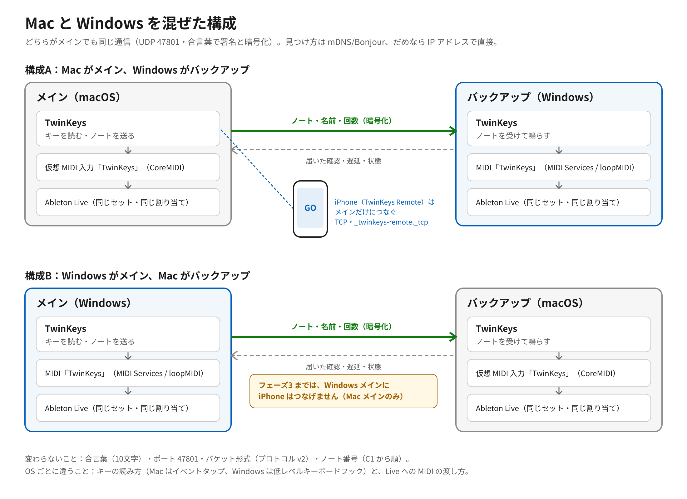
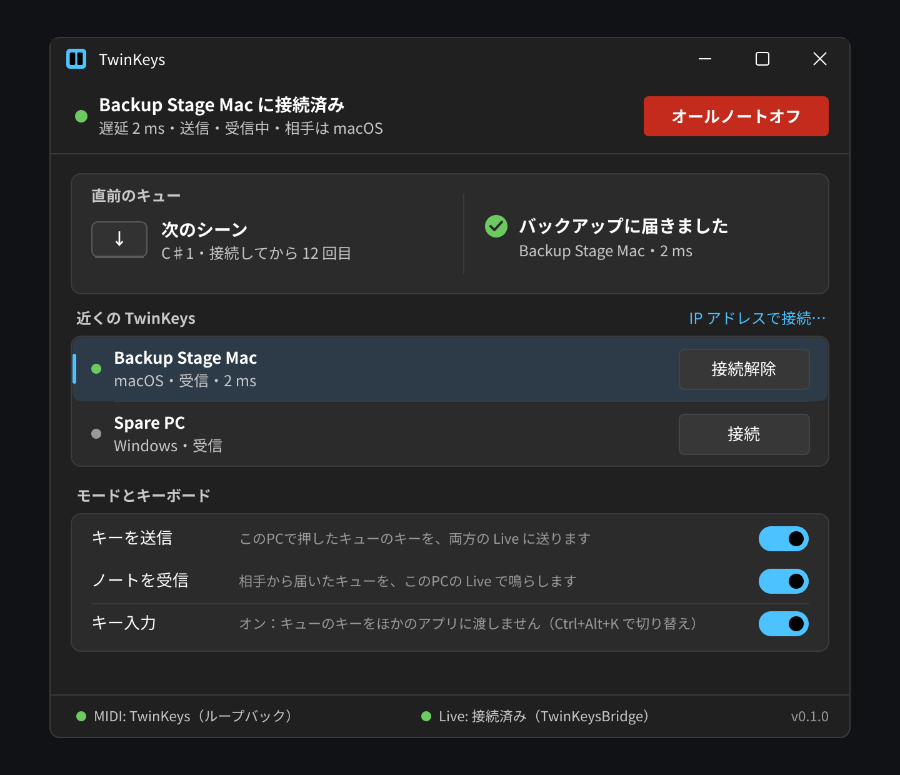
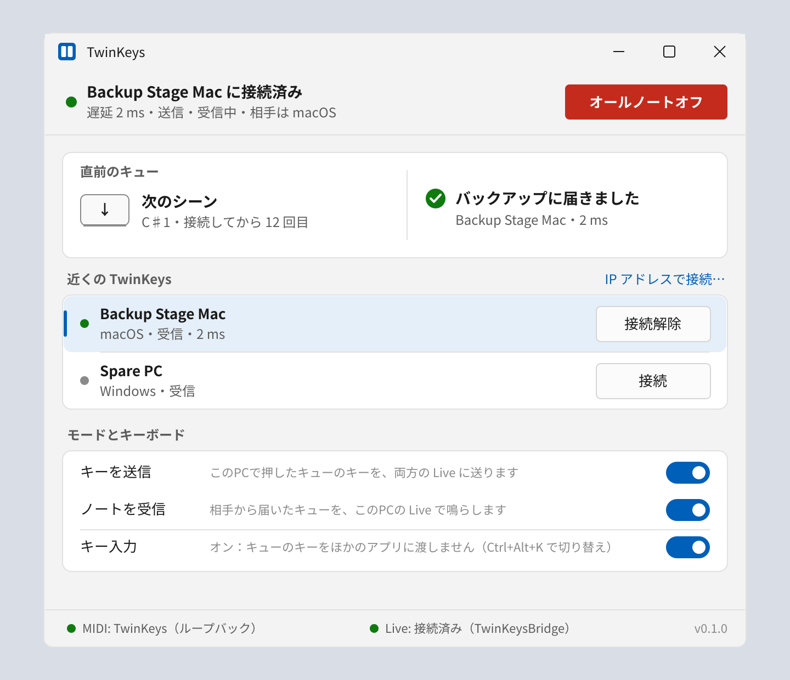
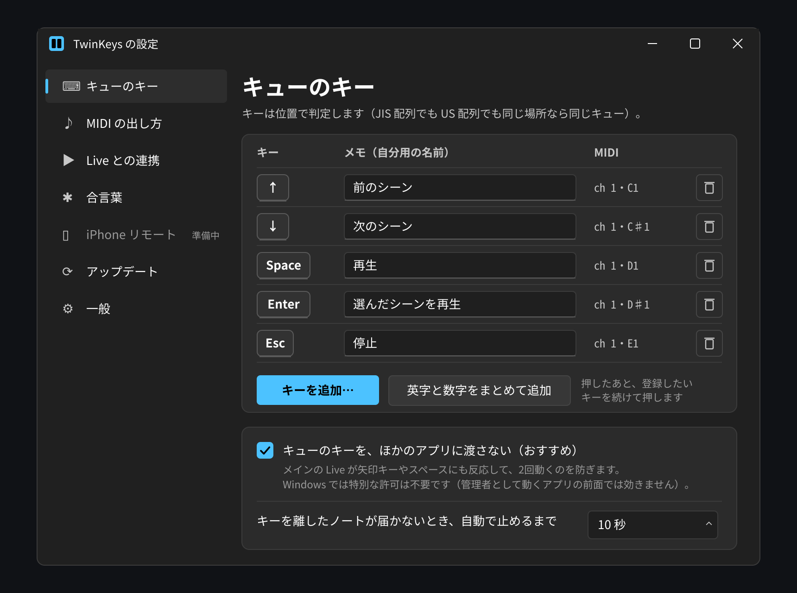
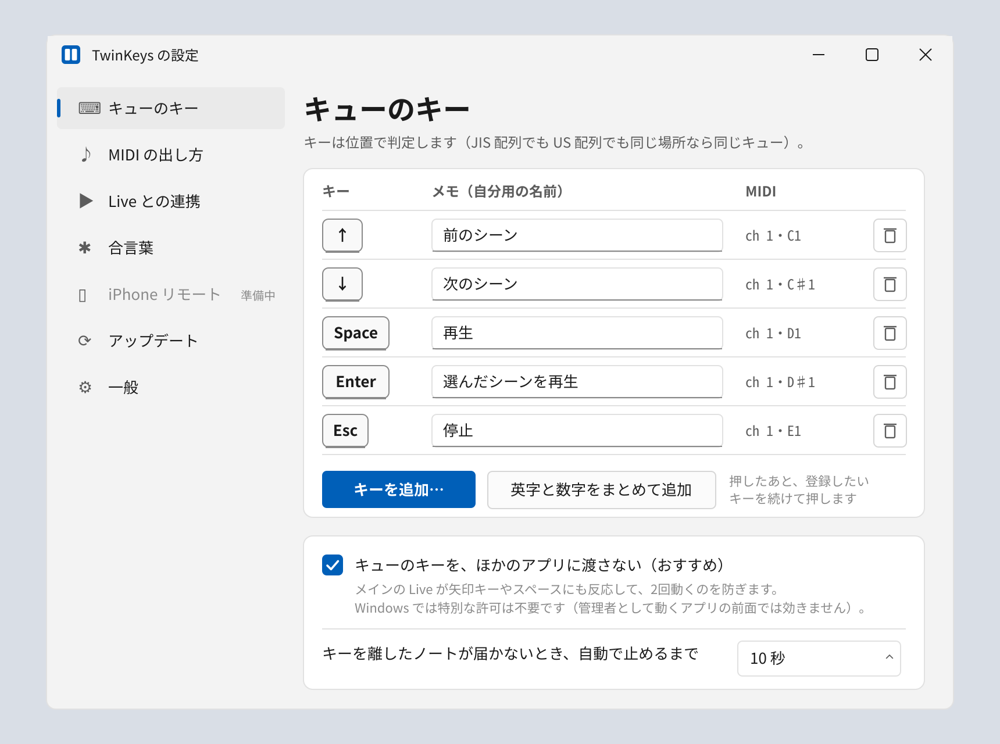
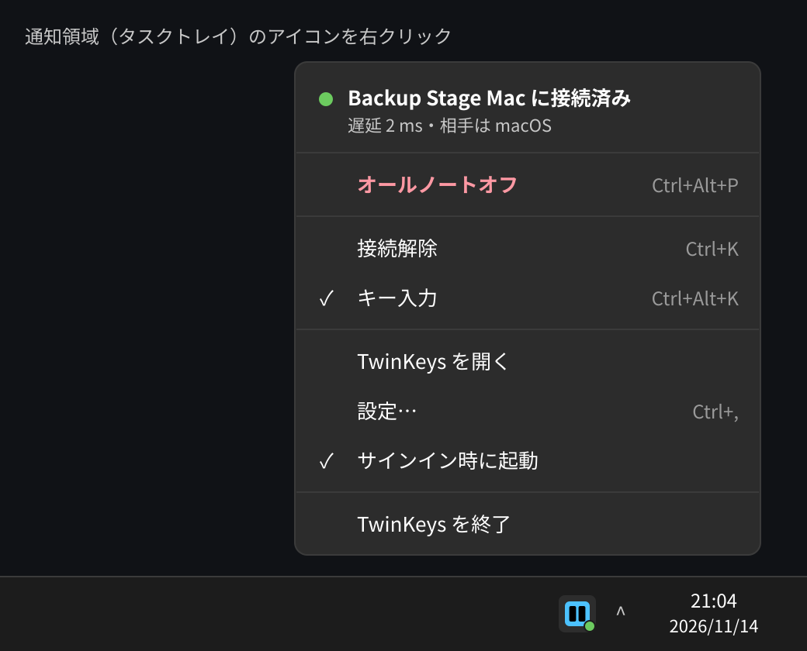
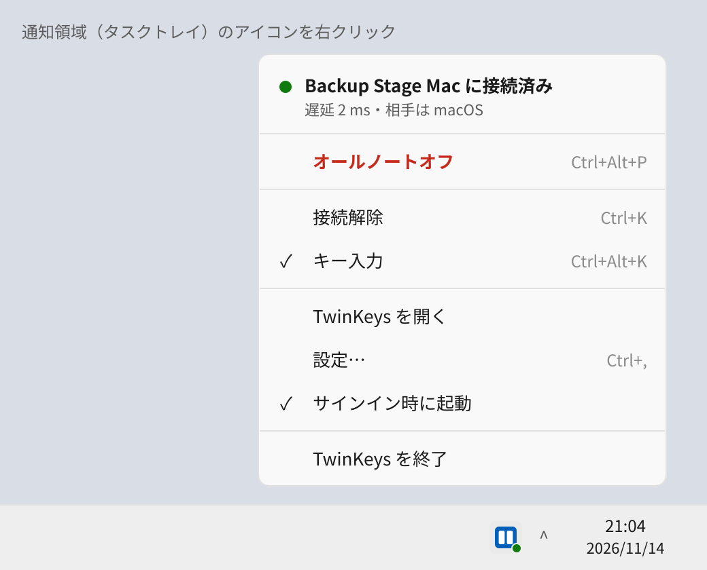
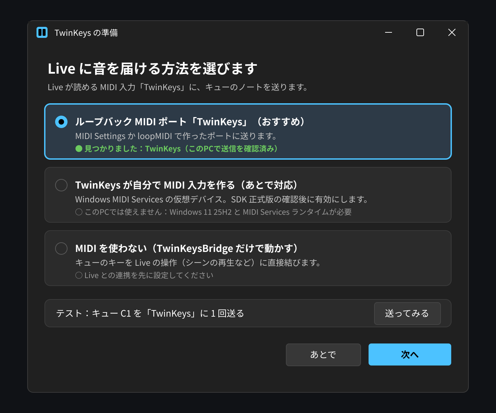

# TwinKeys for Windows 詳細設計書（案）

- 状態：**承認済み。フェーズ1・2・3 を実装しました（`windows/`、0.2.0）。ただし本物の Windows PC・Windows の Live・本物の iPhone ではまだ一度も動かしていません**（CI のビルドとテストだけ）。実装で設計と変えた点はフェーズ1が 14 章、フェーズ2・3 が 15 章。
- 調べた日：2026-11-13（バージョンと値段はこの日の公式ページの内容です）
- 対象：TwinKeys（Mac 版 2.3.0、`VERSION`）と同じ通信で動く Windows 版

この文書では、書いてあることを次の3つに分けます。

| 印 | 意味 |
|---|---|
| **【事実】** | 公式ページか、このリポジトリのソースコードで確かめたこと。URL かファイル名を付けます。 |
| **【推測】** | 事実から考えたこと。外れることがあります。 |
| **【不明】** | 調べても分からなかったこと。本物の Windows PC で試すまで決められません。 |

画面の絵（モックアップ）は `docs/design/windows-*.svg` と同じ名前の `.png` です。

---

## 0. まとめ（先に結論）

1. **作り方**：C# / .NET 10（LTS）＋ WinUI 3（Windows App SDK 2.6、安定版）で作ります。比べた結果は「2. 技術選定」にあります。
2. **対応する Windows**：Windows 11（x64 と ARM64）。Windows 10 は対象外にします（理由は 2.4）。
3. **Mac との混在**：Mac メイン＋Windows バックアップも、その逆も、**今の Mac 版を変えずに**つながるようにします。通信の形・暗号・鍵の作り方を1バイトも変えずに C# で作り直し、Swift 側のテストから作る「共通テストデータ」で同じ結果になることを確かめます（6 章）。
4. **Live への渡し方**：Windows には Mac の CoreMIDI のような「アプリが自分で MIDI 入力を作る」標準の方法がまだ正式版になっていません。そこで最初は、**ループバック MIDI ポート「TwinKeys」に送る**方式（安定した WinMM の送信 API だけを使う）にします。Windows MIDI Services の仮想デバイスは、SDK の正式版が出て本物の PC で確かめてから足します（4 章）。
5. **配布**：MSIX パッケージを Microsoft Store で配るのを第一にします（個人の登録は無料、署名は Store がしてくれ、SmartScreen の警告が出ない）。Azure の Artifact Signing は**日本の個人は使えません**（7 章）。
6. **段階**：フェーズ1＝キューのキーと UDP 通信（Mac とつながる）、フェーズ2＝Live との連携（TwinKeysBridge）、フェーズ3＝iPhone リモートの受け口。



---

## 1. 要件

### 1.1 やりたいこと（ユーザーの希望）

- (1) TwinKeys を Windows で使いたい。
- (2) Mac と Windows を混ぜたい。Mac メイン＋Windows バックアップ、Windows メイン＋Mac バックアップの両方。

### 1.2 機能の要件

| # | 要件 | フェーズ |
|---|---|---|
| F1 | メインの PC で、登録したキューのキーを押すと、決まったノート（ch1、C1=36 から順、ベロシティ 127）を出す | 1 |
| F2 | 出したノートを、このPCの Live（MIDI 入力「TwinKeys」）と、相手の Mac/PC の両方に届ける | 1 |
| F3 | バックアップは、届いたノートをこのPCの Live に渡す | 1 |
| F4 | 届いた確認（0.1 秒ごとに再送、0.3 秒で赤表示）、回数を2台で同じにする、キーの名前とメモを相手に見せる | 1 |
| F5 | 合言葉（10文字）でつなぐ。合言葉が違う相手とはつながらない。通信は署名と暗号化 | 1 |
| F6 | 相手を mDNS/Bonjour で見つける。見つからないときは IP アドレスで直接つなぐ | 1 |
| F7 | オールノートオフ、ノートオフが届かないときの自動停止、回線が切れたときの停止 | 1 |
| F8 | キューのキーをほかのアプリに渡さない（メインの Live が2回動かないように） | 1 |
| F9 | 「メイン役」の主張（roleClaim）と引き継ぎ（roleHandover）を Mac と同じに扱う | 1 |
| F10 | TwinKeysBridge（Live の Remote Script）を入れる・つなぐ・状態を見る・Live の操作を2台に送る・セットの見比べ | 2 |
| F11 | MIDI を使わず、キューを TwinKeysBridge 経由で Live の操作にする方式（4.4） | 2 |
| F12 | iPhone（TwinKeys Remote）を Windows メインにつなぐ受け口 | 3 |

### 1.3 機能以外の要件

- 本番中に勝手に再起動・入れ替えをしない（Mac 版と同じ方針。`docs/help/ja.md`「アップデート」）。
- 通信が遅れない：キーを押してから相手に送るまで、Mac 版と同じ程度（LAN で数 ms）。
- 画面の言葉は日本語と英語（Mac 版と同じく「システムと同じ／English／日本語」）。
- 開発者は Mac も Windows PC も持っていない（iPhone だけ）。**ビルドとテストは GitHub Actions の Windows ランナーで行う**。本物の PC が要る確認は 9 章にまとめます。

### 1.4 やらないこと

- Yamaha 卓の連携（Mac 2.4 の実験機能、パケット 0x22）は Windows 版では作りません。届いても読み捨てます（6.3）。
- Apple Watch 関係の表示（iPhone 側の機能）は、フェーズ3 で受け取った値を表示するだけです。
- Windows 10、32 ビット版 Windows は対象外。

---

## 2. 技術選定

### 2.1 比べた候補（3つ）

| | A. C# / .NET 10 ＋ WinUI 3 | B. Rust ＋ Slint（または egui） | C. Tauri 2（Rust ＋ WebView2） |
|---|---|---|---|
| **動作の軽さ** | 良い。ネイティブの UI。.NET の起動に少し時間がかかる【推測】 | とても良い。ネイティブのバイナリ【推測】 | 良い。ただし UI は WebView2（Edge の部品）で動くので、メモリは多め【推測】 |
| **配布サイズ** | 中。.NET と Windows App SDK を同梱すると数十 MB【推測・CI で実測する】 | 小。数 MB【推測】 | 小。公式は「最小のアプリは 600KB 未満」【事実】。WebView2 は Windows 10（2018年4月以降）と 11 に入っている【事実】 |
| **作りやすさ** | 高い。UDP・暗号（HMAC、PBKDF2、ChaCha20-Poly1305、HKDF）が標準ライブラリにある【事実】。Win32 API（キーボードフック、WinMM、トレイ）も CsWin32 で呼べる | 中。Win32 は windows クレートで呼べるが、UI 部品は自分で作る部分が多い | 中。UI は HTML/CSS で作りやすいが、キーフック・MIDI・UDP は Rust 側で書くので、2つの言語を行き来する |
| **対応 OS** | Windows 10 1809 以降（Windows App SDK の条件）【事実】。この設計では Windows 11 に絞る | Windows・Mac・Linux | Windows・Mac・Linux・iOS・Android【事実】 |
| **将来性** | Microsoft が「新しい Windows デスクトップアプリのおすすめ」としている【事実】。.NET 10 は 2028-11-14 までサポート【事実】 | Rust 自体は安定（1.100.0）【事実】。Slint は 1.x【事実】 | 2.x が活発に更新（2.12.5、2026-11-06）【事実】 |
| **AIでの書きやすさ** | 高い。C# と WinUI/WPF の例が非常に多い【推測】 | 中。Rust は型が厳しく、AI の書いたコードがコンパイルを通るまで直しが要ることが多い【推測】 | 中。Web 部分は書きやすいが、Rust 側と境目のコードで間違えやすい【推測】 |

出典：
- .NET のサポート期間：https://dotnet.microsoft.com/en-us/platform/support/policy/dotnet-core
- Windows App SDK（Windows 10 1809 以降、WinUI がおすすめ）：https://learn.microsoft.com/en-us/windows/apps/windows-app-sdk/
- Windows App SDK の最新版：https://learn.microsoft.com/en-us/windows/apps/windows-app-sdk/downloads
- .NET の暗号（ChaCha20Poly1305 など）：https://learn.microsoft.com/en-us/dotnet/standard/security/cross-platform-cryptography
- Rust 安定版：https://static.rust-lang.org/dist/channel-rust-stable.toml（1.100.0、2026-11-09）
- Slint：https://crates.io/crates/slint（1.18.1）／egui：https://crates.io/crates/egui（0.37.0）／windows クレート：https://crates.io/crates/windows（0.62.2）
- Tauri（600KB 未満）：https://v2.tauri.app/start/ ／（WebView2 の入れ方）：https://v2.tauri.app/distribute/windows-installer/ ／版：https://crates.io/crates/tauri（2.12.5）

### 2.2 おすすめ：A（C# / .NET 10 ＋ WinUI 3）

理由：
1. **通信の作り直しが一番楽で確実**。TwinKeys の芯は「UDP」「HMAC-SHA256」「PBKDF2」「ChaCha20-Poly1305」「HKDF」「X25519」です。.NET には最初の4つ（と HKDF）が標準で入っていて【事実】、外部ライブラリに頼らずに作れます。X25519（フェーズ3 だけで使う）は 2.5 で扱います。
2. **Windows 専用の部分（キーボードフック、WinMM、通知領域、mDNS）をすべて同じ言語で書ける**。Tauri だと Rust と Web の2言語、Rust 単体だと UI 部品を自作する量が増えます。
3. **Mac 版の作りと似せやすい**。Mac 版は「Core（ロジック、OS に関係ない）＋ App（画面と OS 部分）」に分かれています（`Sources/TwinKeysCore` と `Sources/TwinKeys`）。C# でも `TwinKeys.Core`（OS に関係ない）と `TwinKeys.App`（WinUI）に分けられ、Core は Linux の CI でもテストできます。
4. **AI で書くとき間違いが少ない**。開発者が実機を持たないので、コンパイルとテストを CI で回して直す回数が少ない言語が向いています【推測】。

参考（表に入れなかった候補）：**Swift on Windows** で今の `TwinKeysCore` をそのまま使う手もあります。Swift 6.4.1 は Windows（x86_64・arm64）向けが出ています【事実】（https://www.swift.org/install/windows/）。ただし Windows の画面（WinUI）を Swift から使う方法は公式に用意されていない【不明に近い：公式の手順が見つからない】ので、今回は選びません。

### 2.3 WinUI 3 と WPF のどちらにするか

| | WinUI 3（Windows App SDK 2.6.5） | WPF（.NET 10） |
|---|---|---|
| 状態 | 安定版チャンネル【事実】 | .NET に入っていて安定。ただし **Fluent（Windows 11 風）の見た目は、`ThemeMode` が「試験的（Experimental, WPF0001）」**【事実】 |
| Windows 11 らしい見た目 | 標準の部品がそのまま Fluent | 試験的な機能を使うか、自分で作る |
| 通知領域（トレイ）アイコン | 標準の部品がない。Win32 の `Shell_NotifyIcon` を呼ぶ | WinForms の `NotifyIcon` を借りられる |
| 配布 | Windows App SDK ランタイムが要る（同梱できる） | .NET だけ |

出典：
- WinUI 3 / Windows App SDK 2.6.5（2026-11-02、安定版）：https://learn.microsoft.com/en-us/windows/apps/windows-app-sdk/downloads
- WPF の `ThemeMode` は Experimental：https://learn.microsoft.com/en-us/dotnet/api/system.windows.application.thememode
- WPF .NET 10 の Fluent は「まだ作業中（still in progress）」：https://learn.microsoft.com/en-us/dotnet/desktop/wpf/whats-new/net100
- `Shell_NotifyIcon`：https://learn.microsoft.com/en-us/windows/win32/api/shellapi/nf-shellapi-shell_notifyiconw

**決定：WinUI 3。** ユーザーのルール「試験的・ベータの技術は理由なしに使わない」に合うのは、Fluent の見た目が安定版で使える WinUI 3 です。トレイアイコンは Win32 API を直接呼びます（コミュニティ製の H.NotifyIcon.WinUI は安定版が 2.4.1 ですが、外部依存を減らすため使いません）。

### 2.4 使うものとバージョン（2026-11-13 時点）

| 部品 | バージョン | 状態 | 出典 |
|---|---|---|---|
| .NET | **10**（最新パッチ 10.0.15）LTS、2028-11-14 まで | 安定 | https://dotnet.microsoft.com/en-us/platform/support/policy/dotnet-core |
| （参考）.NET 11 | 11.0.0、2026-11-10 公開、STS（2028-11-14 まで） | 安定だが STS | 同上 |
| Windows App SDK（NuGet `Microsoft.WindowsAppSDK`） | **2.6.5**（2026-11-02） | 安定 | https://learn.microsoft.com/en-us/windows/apps/windows-app-sdk/downloads ／ https://www.nuget.org/packages/Microsoft.WindowsAppSDK |
| CsWin32（Win32 API の呼び出しを自動生成） | 0.3.371 | 0.x だが安定版扱いで公開【推測：版番号が 1 未満】 | https://www.nuget.org/packages/Microsoft.Windows.CsWin32 |
| CommunityToolkit.Mvvm | 8.4.2 | 安定 | https://www.nuget.org/packages/CommunityToolkit.Mvvm |
| xUnit v3（テスト） | 4.0.3 | 安定 | https://www.nuget.org/packages/xunit.v3 |
| BouncyCastle.Cryptography（フェーズ3 の候補） | 2.7.0 | 安定 | https://www.nuget.org/packages/BouncyCastle.Cryptography |

**.NET 10 を選ぶ理由**：.NET 11 は 3日前に出たばかりの STS で、サポート終了日は .NET 10 と同じ 2028-11-14 です【事実】。新しさの得はフェーズ3 の X25519 だけ（2.5）なので、LTS の 10 にします。

**Windows 11 に絞る理由**：
- .NET の ChaCha20Poly1305 は Windows では「Windows 10 Build 20142 以降」でしか使えません【事実】（https://learn.microsoft.com/en-us/dotnet/standard/security/cross-platform-cryptography）。Windows 10 の最後の版 22H2 は Build 19045 なので使えません【推測：22H2 のビルド番号は一般に知られている値。公式の表で確かめていない】。
- Windows 10 は 2025-10-14 にサポートが終わり、個人向けの延長（ESU）も 2026-10-13 に終わっています【事実】（https://learn.microsoft.com/en-us/windows/release-health/release-information 、https://learn.microsoft.com/en-us/windows/whats-new/extended-security-updates）。
- Ableton Live 12 の条件は「Windows 10（22H2）または Windows 11（22H2 以降）」【事実】（https://www.ableton.com/en/trial/）。Windows 11 に絞っても Live の条件の中に入ります。

### 2.5 フェーズ3 の X25519 について

- iPhone との接続（`RemoteChannel.swift`）は X25519 の鍵交換を使います【事実】。
- .NET 10 には X25519 の標準クラスがありません。.NET 11 で `X25519DiffieHellman` が増えました【事実】（https://learn.microsoft.com/en-us/dotnet/core/whats-new/dotnet-11/overview 、https://learn.microsoft.com/en-us/dotnet/api/system.security.cryptography.x25519diffiehellman）。
- 決め方：フェーズ3 を始める時点で .NET 12（LTS）が出ていれば移ります（.NET は偶数版が LTS で毎年11月に出る【推測：これまでの出方から】）。出ていなければ .NET 10 のまま BouncyCastle.Cryptography 2.7.0 の X25519 を使います。どちらでも共通テストデータ（6.6）で同じ結果になることを確かめます。

---

## 3. 画面構成

Mac 版の配置（`docs/design/cue-main-dark.svg`、`cuekeys-settings-*.svg`、`pairing-*.svg`、`menubar-*.svg`）をそのまま使い、Windows のやり方に合わせます。

| Mac 版 | Windows 版 |
|---|---|
| 赤・黄・緑の丸（左上） | 右上に「最小化・最大化・閉じる」。左上にアプリのアイコンと名前 |
| メニューバーの鍵盤アイコン | 通知領域（タスクトレイ）のアイコン。右クリックでメニュー |
| ⌘K、⌃⌘K、⌃⌘P、⇧⌘K、⌘, | Ctrl+K、Ctrl+Alt+K、Ctrl+Alt+P、Ctrl+Shift+K、Ctrl+,（3.5） |
| チェックボックス（Mac 風） | トグルスイッチ（Fluent）。設定の「おすすめ」項目はチェックボックス |
| 「設定」は別ウインドウ（Form） | 「設定」は別ウインドウ。左にメニュー（NavigationView） |
| 「ログイン時に起動」 | 「サインイン時に起動」 |
| 「入力監視」「アクセシビリティ」の許可 | 許可は要らない（5.2）。案内も出さない |

### 3.1 メインウインドウ




上から順に：
1. **接続の行**：緑の丸＋「（相手）に接続済み」、2行目に遅延・送信／受信・相手の OS。右に赤い「オールノートオフ」。
2. **直前のキュー**：押したキー（キーの形）、メモ、ノート名と「接続してから○回目」。右に届いたかの表示（緑のチェック／赤「届いた確認がありません」／灰色「届いたかは確認できません」）。文言は Mac 版と同じ（`docs/help/ja.md`）。
3. **近くの TwinKeys**：見つかった相手の一覧。選んでいる相手は青い縦線。右上に「IP アドレスで接続…」。
4. **モードとキーボード**：「キーを送信」「ノートを受信」「キー入力」の3つのトグル。
5. **下の帯**：MIDI の出し先の状態、Live（TwinKeysBridge）の状態、版番号。

「相手の OS」は、今の Bonjour の TXT レコードには入っていません【事実：`Peers.swift` の `TXTKeys` は id・v・modes・boot だけ】。Windows 版は TXT に `os=win` を足します。Mac 版がこれを読むようにするのは小さな追加の変更で、**入れなくてもつながります**（Mac 版は知らない TXT キーを読まないだけ【事実：`TXTKeys.peer` は決まったキーだけ読む】）。Mac 版が `os` を出さない間は、Windows 版の画面では OS を表示しません。

### 3.2 設定ウインドウ




左のメニュー：
- **キューのキー**：Mac 版の「キューのキー」と同じ表（キー・メモ・MIDI・削除）。「キーを追加…」「英字と数字をまとめて追加」。「キューのキーを、ほかのアプリに渡さない（おすすめ）」。自動ノートオフの秒数。
- **MIDI の出し方**：4章の3つの方式から選ぶ。テスト送信ボタン。
- **Live との連携**：TwinKeysBridge を入れる・状態（フェーズ2）。
- **合言葉**：Mac 版の「合言葉を設定…／新しく作る／合言葉を入力…」と同じ流れ。このPCの IP アドレスを表示。
- **iPhone リモート**：フェーズ3 までは「準備中」と灰色で表示。
- **アップデート**：版番号と確認ボタン（7.4）。
- **一般**：言語、サインイン時に起動、ウインドウを閉じたら通知領域に残す。

### 3.3 通知領域（タスクトレイ）のメニュー




Mac のメニューバーのメニューと同じ並び：接続の状態、オールノートオフ（赤）、接続／接続解除、キー入力、TwinKeys を開く、設定…、サインイン時に起動、TwinKeys を終了。

アイコンの形は Mac と同じ考え方：つながっている＝塗りつぶし＋緑の点、つながっていない＝線だけ、つなぎ直し中＝「!」付き。ウインドウを閉じても TwinKeys は動き続けます（Mac 版と同じ）。

### 3.4 はじめての準備（MIDI の出し方を選ぶ）



Windows では MIDI の出し方が PC ごとに違うので、初回だけこの画面を出します（4章）。「送ってみる」で C1 を1回出し、Live の MIDI インジケーターが光るかを見てもらいます。

### 3.5 ショートカット

| 操作 | Mac | Windows | 種類 |
|---|---|---|---|
| 接続／接続解除 | ⌘K | Ctrl+K | アプリの中だけ |
| キー入力のオン／オフ | ⌃⌘K | Ctrl+Alt+K | **どのアプリが前でも効く**（`RegisterHotKey`） |
| オールノートオフ | ⌃⌘P | Ctrl+Alt+P | どのアプリが前でも効く |
| IP アドレスで接続 | ⇧⌘K | Ctrl+Shift+K | アプリの中だけ |
| 設定 | ⌘, | Ctrl+, | アプリの中だけ |
| 使い方 | ⌘? | F1 | アプリの中だけ |

`RegisterHotKey`：https://learn.microsoft.com/en-us/windows/win32/api/winuser/nf-winuser-registerhotkey
Ctrl+Alt の組み合わせが Live や他のアプリと重なるかは【不明】。重なったら設定で変えられるようにします。

---

## 4. Live への MIDI の渡し方（一番大きな課題）

### 4.1 前提

- Mac 版は CoreMIDI で「TwinKeys」という仮想 MIDI 入力を自分で作ります【事実：`VirtualMIDIPort.swift`】。
- Windows の昔からの MIDI API（WinMM、`midiOutOpen` など）には、アプリが自分で MIDI 入力を作る方法がありません【事実：Microsoft の説明「WinMM は…ループバックや仮想デバイスを作る新機能を提供しない」 https://devblogs.microsoft.com/windows-music-dev/windows-midi-services-oct-2024-update/】。
- Ableton の公式ヘルプも、Windows には仮想 MIDI のしくみが入っていないので loopMIDI などを使うよう案内しています【事実（ただし本文は取得できず、検索結果の抜粋で確認）：https://help.ableton.com/hc/en-us/articles/209774225-Setting-up-a-virtual-MIDI-bus】。
- Live for Windows がどの MIDI API（WinMM か、それ以外か）で MIDI を読んでいるかは、Ableton の公式ページで確かめられませんでした【不明】。ユーザーの前提（WinMM / MIDI 1.0）で設計します。

### 4.2 Windows MIDI Services（新しいしくみ）で分かったこと

| 項目 | 内容 | 印 |
|---|---|---|
| 対応 Windows | **Windows 11 25H2 以降**。Windows 10 は動かず対象外 | 【事実】https://github.com/microsoft/MIDI/releases（In-box Preview 13 の説明） |
| 入り方 | Windows 11 に組み込み、段階的に有効化される。使うには別に「SDK Runtime and Tools」を入れる | 【事実】https://blogs.windows.com/windowsexperience/2026/02/17/making-music-with-midi-just-got-a-real-boost-in-windows-11/ |
| アプリ用 SDK | NuGet パッケージ `Windows.Devices.Midi2`、最新は **0.99.92-preview.11（プレビュー）**。nuget.org では見つからず、GitHub のリリースで配布 | 【事実】https://github.com/microsoft/MIDI/releases ／ https://microsoft.github.io/MIDI/sdk-overview/ 【推測：nuget.org の検索に出ない＝GitHub だけで配布】 |
| 正式版 | リリースノートに「2026年11月の最終週から Windows 11 25H2 以降に出す予定」とあるが、決まった事実ではない | 【不明】 |
| 仮想デバイス | 新しい SDK を使う MIDI 2.0 対応のアプリだけが作れる。作ったアプリが切ると消える | 【事実】https://microsoft.github.io/MIDI/kb/virtual-device-app/ |
| WinMM のアプリから見えるか | 表では「使う側にはなれる（Yes）」。ただし「動的に作るポートは番号の扱いに難しさがあるが、MIDI 1.0 ポートとして**任意で**見せられる」 | 【事実】同上 |
| **Live から実際に見えるか** | 確かめた情報がない。Live 12 のリリースノートにも MIDI Services の記載がない | **【不明】**（https://www.ableton.com/en/release-notes/live-12/ 、最新 12.4.16） |
| ループバック | MIDI 1.0 の「Basic Loopback」と MIDI 2.0 の「Loopback」がある。利用者が「MIDI Settings」アプリで作れる | 【事実】https://microsoft.github.io/MIDI/overview/ 、上の Windows ブログ |
| 古いアプリとの関係 | WinMM と WinRT MIDI 1.0 は新しいサービスにつなぎ直され、複数のアプリで同じポートを使える | 【事実】https://microsoft.github.io/MIDI/overview/ |
| ポート名 | 初期値は昔と同じ名前（DAW に保存された名前と合うように） | 【事実】上の Windows ブログ |

### 4.3 方式の比較

| 方式 | 中身 | 必要なもの | 使う API の状態 | 決定 |
|---|---|---|---|---|
| **M1. ループバックポートに送る** | 利用者が「TwinKeys」という名前のループバック MIDI ポートを作る。TwinKeys は WinMM の `midiOutOpen`／`midiOutShortMsg` でその片側に送り、Live はもう片側を入力として読む | Windows MIDI Services の Basic Loopback（MIDI Settings で作る）**または** loopMIDI | WinMM は昔からの安定 API【事実】 | **フェーズ1 の標準** |
| M2. 仮想デバイスを自分で作る | `Windows.Devices.Midi2` で仮想デバイス「TwinKeys」を作る（Mac 版と同じ体験） | Windows 11 25H2＋SDK Runtime | **プレビュー**【事実】 | SDK 正式版＋本物の PC で Live から見えるのを確かめてから足す |
| M3. MIDI を使わない | キューのキーを TwinKeysBridge 経由で Live の操作（シーン再生など）に直接変える（4.4） | TwinKeysBridge | 自前（Python） | フェーズ2 |

WinMM の送信 API：https://learn.microsoft.com/en-us/windows/win32/api/mmeapi/nf-mmeapi-midioutshortmsg

**M1 を標準にする理由**：ルール「ベータの技術は理由なしに使わない」に合い、Windows 11 のどの版でも（loopMIDI を使えば）動くからです。TwinKeys は送るだけなので、ポートを作る部分は OS か loopMIDI に任せます。

### 4.4 loopMIDI と teVirtualMIDI（第三者のループバック）

| | loopMIDI | teVirtualMIDI SDK |
|---|---|---|
| 作者 | Tobias Erichsen | 同じ |
| 何か | 仮想ループバック MIDI ケーブル（利用者が入れるアプリ） | アプリが自分で名前付きの MIDI ポートを作れるドライバーの SDK |
| 書かれている対応 OS | 「Windows 7 から Windows 10」。**Windows 11 の記載なし** | 同じ |
| 配布の条件 | ページに再配布の条件は書かれていない。**TwinKeys は同梱せず、利用者に入れてもらう** | 「フリーウェアでもシェアウェアでもない」「この SDK を使うソフトは、作者の許可なしに配布できない」。ドライバーを組み込む MSI は**ライセンスを結んだ人だけ** |
| 出典 | https://www.tobias-erichsen.de/software/loopmidi.html | https://www.tobias-erichsen.de/software/virtualmidi/virtualmidi-sdk.html |

- loopMIDI が Windows 11 と新しい MIDI サービスの上で正しく動くかは【不明】（公式ページに書かれていない。利用者の掲示板には不具合の報告があるが、一次情報ではない）。
- teVirtualMIDI は「許可が要る」「値段が書かれていない」ため、**使いません**。値段と条件は【不明】（作者に問い合わせが必要）。

### 4.5 MIDI を使わない方式（TwinKeysBridge 経由）

TwinKeysBridge の今のコマンド【事実：`LiveBridge/README.md`、`LiveBridge/TwinKeysBridge/commands.py`】：
`hello`、`fire_scene`、`fire_clip`、`stop_track`、`stop_all`、`play`、`stop`、`continue`、`set_tempo`、`set_volume`、`set_pan`、`set_send`、`set_mute`、`set_solo`、`select_scene`。通信は 127.0.0.1 の UDP（47811 へ命令、47812 へ状態）だけ。

分かったこと：
- 「ノートを送る」コマンドは**ありません**。Remote Script から、利用者が MIDI マップモードで作った割り当てを直接動かす方法も、公式の資料では見つけられませんでした【不明】。
- そのため M3 は、Live の MIDI マップの代わりに **TwinKeys の中に「キュー → Live の操作」の表を持つ**方式になります（例：↓＝次のシーンを選ぶ、Enter＝選んだシーンを再生、Esc＝全部止める）。
- 今のコマンドで足りないもの：「選んでいるシーンを1つ上／下へ」「選んでいるシーンを再生」。TwinKeys 側で `song` の `selected_scene` を見て `select_scene(n±1)` を送ることもできますが、Live の状態とずれる危険があります【推測】。**TwinKeysBridge に `select_scene_relative`（delta）と `fire_selected_scene` を足す**案にします（BRIDGE_VERSION 3 → 4、Mac 版にも同じものが入る）。

Windows の Live で Remote Script が動くか：
- Live 11 以降の Remote Script は Python 3、ユーザーライブラリの「Remote Scripts」フォルダーに置けば設定に出る（Live 10.1.13 以降）【事実（Ableton の記事は 403 で本文を読めず、検索結果の抜粋で確認）：https://help.ableton.com/hc/en-us/articles/209072009-Installing-third-party-remote-scripts】。
- Live の公式マニュアルは「コントロールサーフェス」の設定を OS を分けずに説明している【事実：https://www.ableton.com/en/live-manual/12/midi-and-key-remote-control/】。
- Windows でのフォルダーの場所は、一般には `%USERPROFILE%\Documents\Ableton\User Library\Remote Scripts`【推測：第三者の手順書で一致。公式本文は未確認】。ユーザーライブラリの場所は Live の設定で変えられるので、TwinKeys は既定の場所を探し、なければ利用者に選んでもらいます。
- TwinKeysBridge の Python コードは OS に関係する部分がなく（UDP の 127.0.0.1 だけ）、Windows でも動く見込み【推測】。`constants.py` のバッファの説明は macOS の制限の話なので、Windows では余裕がある【推測】。**本物の Windows＋Live で確かめる必要あり**（9章）。

混在のときの注意：Mac メインが MIDI で鳴らし、Windows バックアップが M3（操作の表）で動かすと、**2台が別の割り当て表で動く**ことになります。片方を直してもう片方を忘れると、違う動きになる危険があります。M3 は「両方が M3」か「Windows だけの2台」で使うのをおすすめにし、混在では M1 をすすめます。

---

## 5. 部品の分け方

### 5.1 全体

```
TwinKeys.App (WinUI 3, net10.0-windows10.0.22621.0)
 ├─ Views/          画面（MainWindow, SettingsWindow, FirstRunWindow, PairingDialog）
 ├─ ViewModels/     画面の状態（CommunityToolkit.Mvvm）
 ├─ Tray/           通知領域アイコン（Shell_NotifyIcon）
 └─ Platform/       Windows の部分（下の表）を Core のインターフェースにつなぐ
TwinKeys.Core (net10.0, OS に関係ない)
 ├─ Wire/           WireProtocol, Packet, SequenceFilter, LiveCommand のバイナリ
 ├─ Crypto/         Pairing, PairingSecret, SecureChannel
 ├─ Link/           LinkStateMachine, Conductor（Mac 版を移す）, NoteGuard, Safety
 ├─ Cues/           CueKey, KeyIds（Windows のキー番号）, 名前
 ├─ Live/           LiveModel, SetCheck, Bridge の JSON（フェーズ2）
 ├─ Remote/         RemoteSession, RemoteMessage の JSON（フェーズ3）
 └─ Settings/       AppSettings と読み書き
TwinKeys.Core.Tests (xUnit v3, net10.0) … Linux・Windows・macOS の CI で動く
TwinKeys.Interop.Tests … 共通テストデータ（6.6）を読んで確かめる
```

Core は Mac 版 `TwinKeysCore` の**ファイル単位の移植**にします。名前と分け方をそろえると、Mac 版を直したときに Windows 版のどこを直すか分かりやすくなります【推測】。

### 5.2 Windows の部分（Platform）

| 役目 | Mac 版 | Windows 版 | 出典 |
|---|---|---|---|
| キーを読む | CGEvent のイベントタップ（入力監視・アクセシビリティの許可） | **低レベルキーボードフック** `SetWindowsHookEx(WH_KEYBOARD_LL)`。専用のスレッドとメッセージループで動かし、処理はすぐ別スレッドに渡す | https://learn.microsoft.com/en-us/windows/win32/winmsg/lowlevelkeyboardproc |
| キーを止める（ほかのアプリに渡さない） | 遮断できるタップ | フックの中で 0 以外を返すと止まる | 同上 |
| MIDI を出す | CoreMIDI の仮想入力 | M1：WinMM `midiOutShortMsg`／M2：`Windows.Devices.Midi2`（あとで） | 4章 |
| 相手を探す | Network.framework の Bonjour | `DnsServiceRegister`／`DnsServiceBrowse`（Windows 10 以降） | https://learn.microsoft.com/en-us/windows/win32/api/windns/nf-windns-dnsserviceregister ／ https://learn.microsoft.com/en-us/windows/win32/api/windns/nf-windns-dnsservicebrowse |
| UDP | NWListener / NWConnection | `System.Net.Sockets.Socket`（UDP、IPv4 と IPv6） | — |
| 合言葉の保存 | キーチェーン | DPAPI（`ProtectedData`、このユーザーだけ読める） | https://learn.microsoft.com/en-us/dotnet/api/system.security.cryptography.protecteddata |
| メニューバー | NSStatusItem | `Shell_NotifyIcon` | 2.3 |
| どこでも効くショートカット | — | `RegisterHotKey` | 3.5 |
| ファイアウォール | ローカルネットワークの許可 | MSIX の `desktop2:FirewallRules`（UDP 47801 受信、プライベートとドメイン） | https://learn.microsoft.com/en-us/uwp/schemas/appxpackage/uapmanifestschema/element-desktop2-firewallrules |

キーボードフックについて：
- **許可**：通常のアプリでも使え、Mac のような許可の画面はありません【事実：上の公式ページに許可の記載がない】【推測：許可が要らないという書き方は公式にはない】。
- **管理者として動くアプリが前にあるときは、そのキーは届かない**（UIPI：低い権限のプロセスは高い権限の UI に触れない）【事実】https://learn.microsoft.com/en-us/windows/win32/winauto/uiauto-securityoverview 。Live をふつうに起動していれば問題ない【推測】。
- **時間切れで黙って外れる**：フックの処理が `LowLevelHooksTimeout`（Windows 10 1709 以降は最大 1000 ms）を超えると、Windows 7 以降はフックが黙って外される【事実】（上の LowLevelKeyboardProc のページ）。対策：フックの中ではキューかどうかの判定と止めるかどうかだけを決め、送信は別スレッド。さらに「最後にキーを受けた時刻」と GetLastInputInfo を比べ、外れたらフックを付け直して画面に出す【推測：この検出方法は設計案】。
- **.NET の注意**：フックのコールバックはガベージコレクターに動かされないよう static にする【事実】https://learn.microsoft.com/en-us/windows/win32/api/winuser/nf-winuser-setwindowshookexw 。
- **ウイルス対策ソフト**：キーボードフックを使うアプリが「キーロガー」と疑われるかは、Microsoft Defender などの公式資料で確かめられませんでした【不明】。対策として、署名する（7章）、Store で配る、キーの中身を記録しない（キューのキーかどうかだけ判定し、ログにもキー名しか書かない）、使い方に理由を書く、をします【推測】。
- **キーの番号**：Mac 版の `CueKey.keycode` は macOS の仮想キーコードです【事実：`CueKeys.swift`】。Windows 版は**スキャンコード（＋拡張キーの印）**を使い、「文字ではなく位置で判定」を Mac 版と同じにします。キーの番号は相手に送られない（送るのはノート・名前・メモだけ）ので、Mac と番号を合わせる必要はありません【事実：`WireProtocol.swift` の cueName は channel・note・label・memo】。iPhone は番号をそのまま返すだけです【事実：`iOS/Sources/RemoteModel.swift` の `cue(_ keycode:)`】。

---

## 6. 通信の互換（Mac と1バイトも違わないこと）

C# で次のとおりに作ります。出典はすべてこのリポジトリのソースです。

### 6.1 定数

| 項目 | 値 | ファイル |
|---|---|---|
| UDP ポート | 47801（使えないときは空いているポートで待ち、47801 を取り直し続ける） | `Sources/TwinKeys/NetworkService.swift`、`Peers.swift`（`ManualAddress.defaultPort`） |
| Bonjour のサービス名 | `_twinkeys._udp` | `NetworkService.swift` |
| TXT のキー | `id`（インスタンス ID、UUID の大文字の文字列）、`v`（プロトコル版 "2"）、`modes`（"s"、"r"、"sr"、""）、`boot`（起動ごとの UUID） | `Peers.swift` |
| iPhone 用のサービス名 | `_twinkeys-remote._tcp` | `RemoteChannel.swift` |
| Live Bridge | 127.0.0.1:47811（命令）、127.0.0.1:47812（状態） | `LiveBridge/TwinKeysBridge/constants.py` |
| 心拍 | 1 秒ごと、3 秒で切断、つなぎ直しは 1・2・4・5・5… 秒 | `LinkStateMachine.swift` |
| キューの再送 | 0.1 秒ごと、0.3 秒で打ち切り | `Conductor.swift`（`cueResendInterval`、`cueAnswerTimeout`） |
| ノートの送信回数 | noteOn・noteOff・allNotesOff は同じパケットを 2 回送る（同じ seq。受け手は重複を捨てる） | `Conductor.swift`（`redundancy = 2`） |

### 6.2 合言葉と鍵

【事実：`Sources/TwinKeysCore/Pairing.swift`】
- 文字：`23456789ABCDEFGHJKMNPQRSTUVWXYZ`（31文字、0/O/1/I/L なし）、10文字、表示は `XXXXX-XXXXX`。
- 正規化：大文字にし、空白と `-`、`‐`（U+2010）、`－`（U+FF0D）を取る。10文字で、全部が上の文字なら OK。
- 鍵 K：`PBKDF2-HMAC-SHA256(password = 正規化した10文字の UTF-8, salt = "TwinKeys pairing v2" の UTF-8, 回数 = 100000, 長さ = 32)`。
  C#：`Rfc2898DeriveBytes.Pbkdf2(password, salt, 100000, HashAlgorithmName.SHA256, 32)`。
- 指紋（ログ用）：`SHA256("fp" ‖ K)` の先頭 4 バイトを小文字16進。

### 6.3 パケットの形（UDP、ビッグエンディアン、最大 128 バイト）

【事実：`Sources/TwinKeysCore/WireProtocol.swift`】

```
0  'T' 'K'   (0x54 0x4B)
2  版        0x02
3  種類
4  session   u32（起動ごとの乱数、1..2^32-1）
8  seq       u32（1 パケットごとに +1）
12 中身
```

| 種類 | 名前 | 中身 |
|---|---|---|
| 0x01 / 0x02 | hello / helloAck | instanceID 16 バイト（UUID の並びそのまま）＋ nonce 16 ＋ 名前の長さ 1 ＋ 名前（UTF-8、最大 32 バイト、文字の途中で切らない） |
| 0x03 | bye | なし |
| 0x10 | noteOn | ch(0-15)、note(0-127)、vel(0-127) |
| 0x11 | noteOff | ch、note |
| 0x12 | held | ch、個数(≤32)、note… |
| 0x13 | features | flags（bit0 キューの確認、bit1 つなぎ直した）[、epoch] |
| 0x14 | noteAck | seq u32 |
| 0x15 | cueName | ch、note、ラベル長(≤12)、ラベル、メモ長(≤60)、メモ |
| 0x16 | cueResend | 元の seq u32、ch、note、vel、released(0/1) |
| 0x17 | cueCount | seq u32、回数 u32 |
| 0x18 | liveCommand | id u32 ＋ LiveCommand のバイナリ（下） |
| 0x19 | liveAck | id u32 |
| 0x1A | liveStatus | 0/1 |
| 0x1B | setSummary | tracks u16、scenes u16、hash u32 |
| 0x1C | setItem | kind(0/1)、index u16、長さ、名前 |
| 0x1D | liveResult | id u32、code(0 実行、1 Live が拒否、2 Live が答えない) |
| 0x1E | roleClaim | ミリ秒 u64 |
| 0x1F | roleHandover | なし |
| 0x20 | allNotesOff | なし |
| 0x21 | remoteSummary | phones、watch |
| 0x22 | desk | Yamaha 卓（Windows 版は**読み捨てる**） |
| 0x30 / 0x31 | heartbeat / heartbeatAck | ナノ秒 u64 |

- 知らない種類は捨てる（エラーにしない）。値の範囲外は「壊れたパケット」として捨てる（Swift の `decode` と同じ条件）。
- **UUID の並び**：Swift の `UUID.uuid` は RFC 4122 の並び（先頭が上位バイト）。C# の `Guid.ToByteArray()` は先頭3つの欄が逆順なので、**`ToByteArray(bigEndian: true)` と `new Guid(span, bigEndian: true)` を使う**（.NET 8 以降の API）【事実：.NET の Guid の仕様。https://learn.microsoft.com/en-us/dotnet/api/system.guid.tobytearray】。ピア ID の文字列は大文字の `D` 形式（Swift の `uuidString`）。
- LiveCommand のバイナリ【事実：`LiveModel.swift` `encoded()`】：1 fireScene(i16)、2 fireClip(i16,i16)、3 stopTrack(i16)、4 stopAll、5 play、6 stop、7 continue、8 setTempo(f64)、9 setVolume(i16,f64)、10 setPan(i16,f64)、11 setMute(i16,u8)、12 setSolo(i16,u8)、13 selectScene(i16)、14 setSend(i16,u8,f64)。i16 は符号付き、f64 は IEEE 754 のビッグエンディアン。範囲の確認（`isValid`）も同じにする。

### 6.4 署名と暗号（SecureChannel）

【事実：`Sources/TwinKeysCore/SecureChannel.swift`】
- **hello / helloAck**：平文＋タグ。タグ＝`HMAC-SHA256(K, 平文)` の先頭 16 バイト。比べるときは時間が一定の比較。
- **それ以外**：ChaCha20-Poly1305。
  - 方向の鍵：`HMAC-SHA256(K, "dir" ‖ 送り手の nonce ‖ 受け手の nonce)`（32 バイト）。
  - nonce（12 バイト）：パケットの 4〜11 バイト目（session ‖ seq）＋ `00 00 00 00`。
  - 追加認証データ：ヘッダー 12 バイト。
  - 送る形：`ヘッダー ‖ 暗号文 ‖ タグ 16 バイト`。
  - C#：`System.Security.Cryptography.ChaCha20Poly1305`（Windows 10 Build 20142 以降、2.4）。
- 自分の nonce は起動ごとに 16 バイトの乱数。
- 相手の新しい session の hello は、すぐには信じず、その session の暗号化パケットが正しく開けたら切り替える（`Conductor.swift` の `pendingHello`）。

### 6.5 iPhone との通信（フェーズ3）

【事実：`Sources/TwinKeysCore/RemoteChannel.swift`】
- TCP。フレーム＝長さ u32（ビッグエンディアン、最大 4 MiB）＋中身。
- ClientHello / ServerHello は **JSON**（Swift の `JSONEncoder` の出力）＋タグ 32 バイト。タグ＝`HMAC-SHA256(K, "remote" ‖ データ)`。ServerHello のタグは ClientHello と ServerHello をつなげたものにかける。
- 鍵：`HKDF-SHA256(X25519 の共有値, salt = K, info = "TwinKeys remote v1" ‖ SHA256(ClientHello の JSON ‖ ServerHello の JSON), 64 バイト)`。前半 32＝iPhone→Mac、後半 32＝Mac→iPhone。
- その後のメッセージ：`カウンター 8 バイト ‖ 暗号文 ‖ タグ 16`。nonce＝カウンター（ビッグエンディアン 8 バイト）＋ `00 00 00 00`。カウンターは増える一方（古いものは拒否）。
- 確認の4桁：`SHA256(ClientHello の JSON)` の先頭 4 バイトを u32 にして 10000 で割った余り、4桁ゼロ埋め。
- **JSON の形に注意**：中身は Swift の Codable が自動で作った形です。値付きの enum は `{"command":{"id":1,"_1":{...}}}` のように「ケース名 → 中身（ラベルなしは `_0`、`_1`）」になります【事実：Swift の提案 SE-0295 https://github.com/swiftlang/swift-evolution/blob/main/proposals/0295-codable-synthesis-for-enums-with-associated-values.md】。`Data` は Base64 の文字列です【事実：https://developer.apple.com/documentation/foundation/jsonencoder/dataencodingstrategy/base64】。C# の `System.Text.Json` の初期設定とは形が違うので、**自前の変換クラス**を書き、6.6 のテストデータで確かめます。知らないメッセージは捨てる（2.4 以降の Mac と同じ）。

### 6.6 共通テストデータ（2つの作り方が同じことを証明する方法）

1. Swift 側に `Tests/TwinKeysCoreTests/InteropVectorsTests.swift` を足します。環境変数 `TWINKEYS_WRITE_VECTORS=1` のときだけ、固定の入力から作った結果を `shared/test-vectors/*.json` に書き出します。ふだんは、コミット済みの JSON と今の Swift の結果が同じかを確かめるテストとして動きます（Swift を変えて形が変わったら CI が落ちる）。
2. JSON は macOS の CI（今の `ci.yml`、`macos-26`）で作り、リポジトリにコミットします。
3. C# の `TwinKeys.Interop.Tests` が同じ JSON を読み、同じバイトになることを確かめます（Linux と Windows の CI）。

入れるもの（すべて16進の文字列）：

| ファイル | 中身 |
|---|---|
| `pairing.json` | 合言葉の例（作り話の値）→ 正規化 → K → 指紋。RFC 7914 の PBKDF2 の例（すでに `PairingTests.swift` にある） |
| `packets.json` | 6.3 の全種類について、固定の session・seq・中身 → 平文のバイト。長い名前の切り方（日本語の文字の途中で切らない）も |
| `bad-packets.json` | 捨てるべきバイト列（短い、magic 違い、範囲外など）と、期待する理由 |
| `secure.json` | 固定の K・nonce2つ → 方向の鍵、hello のタグ、封をしたパケット（ChaCha20-Poly1305 は nonce を固定すれば毎回同じ結果になる） |
| `livecommand.json` | 14 種類の LiveCommand → バイナリと Bridge の JSON |
| `sequence.json` | SequenceFilter に入れる (session, seq, allowLate) の列と、受け入れるかの答え |
| `remote.json`（フェーズ3） | 固定の X25519 鍵2つ → 共有値 → HKDF の鍵、タグ、確認の4桁、各 RemoteMessage の JSON |

さらに、Core は OS に関係ないので、**macOS の CI の中で C# の Core（コマンドライン版の相手役）を動かし、Swift の Conductor と 127.0.0.1 で実際につなぐテスト**も足せます（.NET は macOS でも動く）【推測：Swift 側にテスト用の小さな起動口を足す必要がある】。これで「hello → helloAck → 心拍 → ノート → 確認」の流れを機械で確かめられます。本物の LAN と Bonjour の確認は 9 章。

サンプルの値には実在の人の名前を使いません（例：名前は「Backup Stage Mac」「Stage PC」、合言葉は `K7MQ2-WX9TP` のような作り話）。

---

## 7. 配布・署名・アップデート

### 7.1 署名の選び方

| 方法 | 値段 | 日本の個人 | SmartScreen | 出典 |
|---|---|---|---|---|
| **Microsoft Store（MSIX）** | **無料**（個人の登録料なし。本人確認は身分証と自撮り） | 使える（約200の市場） | 警告なし（Store が署名し直す） | https://learn.microsoft.com/en-us/windows/apps/publish/whats-new-individual-developer ／ https://learn.microsoft.com/en-us/windows/apps/package-and-deploy/code-signing-options |
| Azure Artifact Signing（旧 Trusted Signing） | Basic 月 9.99 ドル（5,000 回）、Premium 月 99.99 ドル | **使えない**（個人は米国とカナダだけ。日本は「組織」なら可） | 実績がたまるまで警告 | https://learn.microsoft.com/en-us/azure/artifact-signing/quickstart ／ https://learn.microsoft.com/en-us/azure/artifact-signing/how-to-change-sku |
| OV コード署名証明書（認証局から買う） | 年 150〜300 ドル（Microsoft の目安） | 使える | 実績がたまるまで警告 | 上の code-signing-options |
| EV 証明書 | 年 400 ドル以上 | 使える | 今は OV と同じ（すぐには消えない） | https://learn.microsoft.com/en-us/windows/apps/package-and-deploy/smartscreen-reputation |
| SignPath Foundation（オープンソース向け） | 無料 | 条件しだい | 【不明】 | https://signpath.org/ ／ https://signpath.org/terms |
| 署名なし | 無料 | — | 強い警告。「実行」を押せば動く | 上の smartscreen-reputation |

- SignPath Foundation の条件（OSI のライセンス、独自の非公開部分がない、ビルドが元のソースから確かめられる、リリースごとの手動承認、MFA など）に TwinKeys が合うか【不明】。申し込んで確かめる必要があります。
- Store の方針（Microsoft Store Policies 7.20）に、キーボードフックを使うアプリについての記載は見つかりませんでした【不明】。審査で聞かれたら、用途（キューのキーだけを判定し、内容を記録・送信しない）を説明します。https://learn.microsoft.com/en-us/windows/apps/publish/store-policies

### 7.2 MSIX かインストーラーか

| | MSIX | 従来のインストーラー（MSI / exe） |
|---|---|---|
| Store | 署名・ホスティングを Store がする | 自分で署名した MSI/EXE を出す必要あり |
| 外で配る | 信頼された証明書の署名が**必須**（自己署名は入らない） | 署名なしでも入る（警告あり） |
| ファイアウォール | マニフェストで UDP 47801 の例外を宣言できる | インストーラーが管理者権限で規則を足す |
| 消すとき | きれいに消える | インストーラーしだい |

出典：https://learn.microsoft.com/en-us/windows/msix/package/signing-package-overview ／ https://learn.microsoft.com/en-us/windows/apps/desktop/modernize/desktop-to-uwp-extensions

**決定**：
- 正式な配布＝**MSIX を Microsoft Store で**。
- 試してもらう段階（Store の審査前）＝**署名なしの ZIP（Windows App SDK と .NET を同梱した自己完結型）を GitHub Releases に**。SmartScreen の警告が出ることを使い方に書く。
- OV 証明書は、Store 以外でも配る必要が出たときに考える（年 150〜300 ドル）。

### 7.3 アップデート

- Store 版は Store が更新します。**本番中に入れ替わらないこと**が Mac 版の約束です。Store の更新が、アプリが動いている最中に強制終了して入れ替えるのかは【不明】。本物の PC で確かめ、問題があれば「更新を延期する設定」を案内します。
- App Installer ファイル（`.appinstaller`）で GitHub から自動更新する方法もあります（Windows 10 2004 以降、起動時の確認やバックグラウンドの確認を選べる）【事実】https://learn.microsoft.com/en-us/windows/msix/app-installer/auto-update-and-repair--overview 。ただし信頼された署名が必要なので、OV 証明書を買うまでは使いません。
- ZIP 版は、Mac 版と同じ GitHub Releases の確認（`Updates.swift` と同じ考え方）で「新しい版があります」と知らせるだけにし、自分では入れ替えません。
- 第三者の更新ツール Velopack（C# 対応、GitHub Releases に置ける）もあります【事実】https://docs.velopack.io/ 。今回は使いません（Store に任せるため）。

---

## 8. 状態管理とデータ構造

### 8.1 状態の流れ

Mac 版と同じく「時刻を外から入れる、純粋なロジック」＋「OS の部分」に分けます。

```
キーボードフック ─► KeyEvent ─► Conductor ─► MidiOut（このPCの Live）
                                 │  ▲
                     UDP 受信 ───┘  └── LinkStateMachine（心拍・切断・再接続）
                                 │
                                 ▼
                             AppState（読み取り専用のスナップショット）─► ViewModel ─► 画面
```

- `Conductor` は Mac 版 `Conductor.swift` を移したもの。1本の「仕事用スレッド」（`System.Threading.Channels` の受け口）だけが触る。キーのフックと UDP 受信はそこへ投げるだけ。
- 画面は `AppState` のスナップショットを 1 秒に最大 30 回だけ受け取る（`DispatcherQueue` で UI スレッドへ）。画面の都合でキューの処理が遅れないようにする【推測：Mac 版も同じ考え】。
- 時刻は `Stopwatch.GetTimestamp()`（単調時計）。roleClaim だけは壁時計（ミリ秒）【事実：Mac 版がそうしている】。

### 8.2 状態の種類（Mac 版と同じ名前）

| 状態 | 値 |
|---|---|
| 接続 | idle / connecting(peer, attempt, nextRetryAt) / connected(peer) |
| 届いた確認 | delivered / waiting / missing / unconfirmed / notConnected |
| MIDI の出し先 | ready(port名) / notFound / error(文言) |
| Live（フェーズ2） | notInstalled / installedNotSelected / connected(bridgeVersion) / notAnswering |
| キー入力 | on（止める）/ on（読むだけ）/ off / hookLost |

### 8.3 設定ファイル

- 場所：`%LOCALAPPDATA%\TwinKeys\settings.json`（MSIX ではパッケージ専用の場所に自動で振り替えられる【推測】）。ログは `%LOCALAPPDATA%\TwinKeys\Logs\`。
- 形：Mac 版 `Settings.swift` と同じキー名（snake_case）で、Windows 専用のものを足す。読めないファイルは `settings.broken-<時刻>.json` に残して初期値で起動（Mac 版と同じ）。

```json
{
  "version": 1,
  "instance_id": "8F0C2B7E-4D3A-4B8E-9C11-2A6F5E0D9B34",
  "send_keys": true,
  "receive_notes": true,
  "key_capture": true,
  "auto_note_off_seconds": 10,
  "midi_channel": 1,
  "language": "system",
  "manual_address": null,
  "cue_keys": [
    { "key": "sc:0x48:e", "label": "↑", "memo": "前のシーン", "note": 36 },
    { "key": "sc:0x50:e", "label": "↓", "memo": "次のシーン", "note": 37 }
  ],
  "block_cue_keys": true,
  "auto_update": true,
  "tray_only": false,
  "windows": {
    "midi_output": { "mode": "loopback", "port_name": "TwinKeys" },
    "bridge_cues": [ { "note": 37, "action": "select_scene_relative", "delta": 1 } ],
    "hotkeys": { "key_capture": "Ctrl+Alt+K", "all_notes_off": "Ctrl+Alt+P" }
  }
}
```

- `key`：`sc:<スキャンコード>:<e=拡張キー>`。上の例の↑（0x48 拡張）と↓（0x50 拡張）は PC/AT キーボードの一般的な値【推測：本物の PC で確認する】。
- 合言葉は settings.json に**書かない**（DPAPI で別ファイルに保存。Mac 版がキーチェーンに置くのと同じ考え）。
- 上の UUID は例として作った値です。

---

## 9. CI（GitHub Actions）と、本物の PC が要る確認

### 9.1 ランナー

- `windows-2025`（= `windows-latest`、Windows Server 2025、x64）と `windows-11-arm`（Windows 11 Arm64）が使える【事実】https://github.com/actions/runner-images
- Core のテストは `ubuntu-latest` でも動かす（速くて安い）。

### 9.2 ジョブ案（`.github/workflows/windows.yml`）

| ジョブ | ランナー | すること |
|---|---|---|
| core-tests | ubuntu-latest | `dotnet test TwinKeys.Core.Tests`、共通テストデータの確認 |
| build-x64 | windows-2025 | WinUI アプリのビルド（Release、自己完結型）、ZIP と MSIX を作る、成果物として保存 |
| build-arm64 | windows-11-arm | 同じものを ARM64 で |
| smoke | windows-2025 | 起動して 5 秒動き続けるか、メモリの量、終了できるか（Mac の CI と同じ考え） |
| interop | macos-26 | Swift の共通テストデータが変わっていないか／C# の相手役と Swift の Conductor を 127.0.0.1 でつなぐ |

- checkout は今の CI と同じく `actions/checkout@3d3c42e5aac5ba805825da76410c181273ba90b1 # v7.0.1` に固定。
- 秘密の値（Store のアップロード用など）はフェーズ1 では使わない。

### 9.3 CI では確かめられないこと（本物の Windows PC が要る）

| # | 確認すること | なぜ CI でできないか |
|---|---|---|
| R1 | Live 12 for Windows が、ループバックポート「TwinKeys」（MIDI Services の Basic Loopback／loopMIDI）を入力として見て、MIDI マップで割り当てられるか | ランナーに Live も MIDI 機器もない |
| R2 | M2（仮想デバイス）が Live から見えるか | Windows 11 25H2＋MIDI Services が要る。ランナーは Windows Server |
| R3 | キーボードフックで Live にキーが届かなくなるか（「ほかのアプリに渡さない」） | 対話できるデスクトップと Live が要る |
| R4 | Mac（Bonjour）と Windows（mDNS）が互いに見つかるか。ファイアウォールの許可の出方 | 同じ LAN の Mac と PC が要る |
| R5 | 実際の遅延（キー → 相手の Live） | 実機の LAN が要る |
| R6 | TwinKeysBridge が Live for Windows で読み込まれ、127.0.0.1 で話せるか、Remote Scripts フォルダーの場所 | Live が要る |
| R7 | ウイルス対策ソフトに止められないか | 実際の環境が要る |
| R8 | Store の更新が本番中に起きないか | Store 版が要る |
| R9 | JIS 配列と US 配列でキーの位置が合っているか | 実際のキーボードが要る |

開発者が Windows PC を持っていないので、**手伝ってくれる人に渡す確認表**（Mac 版の `docs/manual-test.md` と同じ形）をフェーズ1 の終わりに作ります。

---

## 10. フォルダー構成

```
windows/                          ← リポジトリの直下に新しく作る
  TwinKeys.Windows.sln
  Directory.Build.props           共通の設定（net10.0、Nullable、警告をエラーに）
  src/
    TwinKeys.Core/                OS に関係ない部分（6章の通信、Conductor）
    TwinKeys.App/                 WinUI 3 の画面と Windows の部分
      Package.appxmanifest        MSIX（ファイアウォールの例外を含む）
      Strings/ja-JP/Resources.resw
      Strings/en-US/Resources.resw
    TwinKeys.PeerCli/             テスト用の相手役（コマンドライン、6.6）
  tests/
    TwinKeys.Core.Tests/
    TwinKeys.Interop.Tests/
shared/
  test-vectors/                   Swift が書き出す共通テストデータ（6.6）
.github/workflows/windows.yml
docs/design-windows.md            この文書
docs/design/windows-*.svg/png     画面の絵
```

TwinKeysBridge（`LiveBridge/`）は Mac と Windows で同じものを使います。Windows のアプリは中に同じファイルを入れ、Live のフォルダーにコピーします。

---

## 11. 危険と分からないこと

### 11.1 危険（起きたら困ること）

| 危険 | 起きやすさ | 対策 |
|---|---|---|
| Live がループバックポートや仮想デバイスを見ない、または不安定 | 中【推測】 | M1 と M3 の2つを用意。R1・R2 を最初に確かめる |
| キーボードフックが黙って外れる | 低〜中 | 処理を軽くする、外れたら検出して付け直し、画面に赤で出す |
| ウイルス対策ソフトがキーロガーと疑う | 【不明】 | 署名・Store・記録しない設計・説明 |
| Mac 版を直したのに Windows 版を直し忘れる | 中 | 共通テストデータで CI が落ちるようにする |
| 混在で、Mac は MIDI マップ、Windows は M3 の表、と割り当てがずれる | 中 | 混在では M1 をすすめる。M3 の表を相手に見せる案は後で検討 |
| Swift の JSON の形（iPhone 用）を C# で再現しそこなう | 中 | 6.6 の `remote.json` で全メッセージを確かめる |
| 実機を持つ人がいないので R1〜R9 が確かめられない | 高 | 確認表を作り、協力してくれる人を探す。確かめるまで「試験版」と表示 |

### 11.2 【不明】の一覧

1. Live for Windows がどの MIDI API で読んでいるか（WinMM かどうか）。
2. Windows MIDI Services の仮想デバイスが Live から見えるか。ポート番号や名前の扱い。
3. Windows MIDI Services の SDK（`Windows.Devices.Midi2`）の正式版がいつ出るか（予定は 2026年11月最終週とあるが未確定）。
4. loopMIDI が Windows 11 と新しい MIDI サービスの上で正しく動くか。loopMIDI の再配布の条件（TwinKeys は同梱しないので影響は小さい）。
5. teVirtualMIDI の値段と条件。
6. Remote Script から、利用者が作った MIDI マップを直接動かす方法があるか（なければ M3 は「操作の表」方式）。
7. Windows の Remote Scripts フォルダーの公式の場所（Ableton の記事は 403 で読めなかった）。
8. ウイルス対策ソフトがキーボードフックをどう扱うか。
9. Microsoft Store の審査が、キーボードフックを使うアプリをどう扱うか。
10. Store の自動更新が、動いている最中のアプリを止めて入れ替えるか。
11. SignPath Foundation の条件に TwinKeys が合うか。
12. Windows の mDNS（`DnsServiceBrowse`）が、Mac の Bonjour と同じ LAN で互いに見つけられるか。ファイアウォールの「パブリック」設定のときの動き。
13. Ctrl+Alt+K／Ctrl+Alt+P が Live や他のアプリと重ならないか。
14. 配布サイズ（自己完結型の ZIP と MSIX の実際の大きさ）。CI で測る。

---

## 12. フェーズ

### フェーズ1：キューのキーと UDP 通信（Mac とつながる）

作るもの：
- Core：6.1〜6.4 のすべて（Wire、Crypto、SequenceFilter、LinkStateMachine、Conductor のキュー部分、NoteGuard、Safety、roleClaim／roleHandover、features、cueName、cueCount、cueResend、held、heartbeat）。
- Swift 側：共通テストデータの書き出し（6.6）。TXT に `os` を足すのは任意（3.1）。
- App：メインウインドウ、設定（キューのキー、MIDI の出し方、合言葉、一般）、トレイ、はじめての準備、キーボードフック、M1（WinMM でループバックポートへ）、mDNS と IP 接続、DPAPI、ショートカット。
- 配布：ZIP（署名なし、試験版）。

終わりの条件：
- 共通テストデータがすべて合う（CI）。
- macOS の CI で C# の相手役と Swift の Conductor がつながり、ノートと確認が行き来する（CI）。
- R1・R3・R4・R5・R9 を協力者の実機で確かめた。

### フェーズ2：Live との連携（TwinKeysBridge）

- Bridge を Live のフォルダーに入れる（場所を探す・選ぶ）、状態の受け取り、Live の操作を2台に送る（liveCommand／liveAck／liveResult）、セットの見比べ（setSummary／setItem）。
- M3（MIDI を使わない方式）：キュー → 操作の表。TwinKeysBridge に `select_scene_relative` と `fire_selected_scene` を足す（BRIDGE_VERSION 4。Mac 版も同時に更新）。
- R6 を実機で確かめる。
- Store に出す（審査）。

### フェーズ3：iPhone リモートを Windows で受ける

- RemoteSession（6.5）、承認の流れ（`RemoteApprovalGate`、4桁の確認、60 秒の時間切れと 60 秒の冷却）、承認した iPhone の保存、`_twinkeys-remote._tcp` の公開。
- X25519：.NET 12（LTS）か BouncyCastle（2.5）。
- `remote.json` の共通テストデータ。iPhone の実機での接続確認（開発者の iPhone で確かめられる）。
- M2（仮想デバイス）は、SDK 正式版が出て R2 を確かめられたらこの頃に足す。

---

## 13. この文書で使った主な一次情報

- .NET サポート期間：https://dotnet.microsoft.com/en-us/platform/support/policy/dotnet-core
- .NET 11 の新機能（X25519DiffieHellman）：https://learn.microsoft.com/en-us/dotnet/core/whats-new/dotnet-11/overview
- .NET の暗号の対応表：https://learn.microsoft.com/en-us/dotnet/standard/security/cross-platform-cryptography
- Windows App SDK のダウンロード（2.6.5）：https://learn.microsoft.com/en-us/windows/apps/windows-app-sdk/downloads
- Windows App SDK の概要：https://learn.microsoft.com/en-us/windows/apps/windows-app-sdk/
- WPF .NET 10 の新機能：https://learn.microsoft.com/en-us/dotnet/desktop/wpf/whats-new/net100
- WPF ThemeMode（Experimental）：https://learn.microsoft.com/en-us/dotnet/api/system.windows.application.thememode
- Windows MIDI Services：https://microsoft.github.io/MIDI/ 、https://microsoft.github.io/MIDI/overview/ 、https://microsoft.github.io/MIDI/kb/virtual-device-app/ 、https://microsoft.github.io/MIDI/sdk-overview/ 、https://github.com/microsoft/MIDI/releases
- Windows ブログ（MIDI、2026-02-17）：https://blogs.windows.com/windowsexperience/2026/02/17/making-music-with-midi-just-got-a-real-boost-in-windows-11/
- Windows MIDI の開発者ブログ（2024-10）：https://devblogs.microsoft.com/windows-music-dev/windows-midi-services-oct-2024-update/
- loopMIDI：https://www.tobias-erichsen.de/software/loopmidi.html ／ teVirtualMIDI：https://www.tobias-erichsen.de/software/virtualmidi.html 、https://www.tobias-erichsen.de/software/virtualmidi/virtualmidi-sdk.html
- Ableton Live の動作環境：https://www.ableton.com/en/trial/ ／ Live 12 リリースノート：https://www.ableton.com/en/release-notes/live-12/ ／ Live 12 マニュアル：https://www.ableton.com/en/live-manual/12/midi-and-key-remote-control/
- Ableton ヘルプ（本文は取得できず）：https://help.ableton.com/hc/en-us/articles/209072009-Installing-third-party-remote-scripts 、https://help.ableton.com/hc/en-us/articles/209774225-Setting-up-a-virtual-MIDI-bus
- 低レベルキーボードフック：https://learn.microsoft.com/en-us/windows/win32/winmsg/lowlevelkeyboardproc ／ SetWindowsHookEx：https://learn.microsoft.com/en-us/windows/win32/api/winuser/nf-winuser-setwindowshookexw ／ UIPI：https://learn.microsoft.com/en-us/windows/win32/winauto/uiauto-securityoverview
- DNS-SD：https://learn.microsoft.com/en-us/windows/win32/api/windns/nf-windns-dnsserviceregister 、https://learn.microsoft.com/en-us/windows/win32/api/windns/nf-windns-dnsservicebrowse
- 署名の選び方：https://learn.microsoft.com/en-us/windows/apps/package-and-deploy/code-signing-options ／ SmartScreen：https://learn.microsoft.com/en-us/windows/apps/package-and-deploy/smartscreen-reputation ／ Artifact Signing：https://learn.microsoft.com/en-us/azure/artifact-signing/quickstart 、https://learn.microsoft.com/en-us/azure/artifact-signing/how-to-change-sku
- Store の個人登録（無料）：https://learn.microsoft.com/en-us/windows/apps/publish/whats-new-individual-developer ／ Store の方針：https://learn.microsoft.com/en-us/windows/apps/publish/store-policies
- MSIX の署名：https://learn.microsoft.com/en-us/windows/msix/package/signing-package-overview ／ 自動更新：https://learn.microsoft.com/en-us/windows/msix/app-installer/auto-update-and-repair--overview ／ ファイアウォール例外：https://learn.microsoft.com/en-us/uwp/schemas/appxpackage/uapmanifestschema/element-desktop2-firewallrules
- Windows 10 のサポート終了：https://learn.microsoft.com/en-us/windows/release-health/release-information
- GitHub Actions のランナー：https://github.com/actions/runner-images
- SignPath Foundation：https://signpath.org/ 、https://signpath.org/terms
- Velopack：https://docs.velopack.io/
- Tauri：https://v2.tauri.app/start/ 、https://v2.tauri.app/distribute/windows-installer/
- Swift on Windows：https://www.swift.org/install/windows/
- Swift の Codable（enum）：https://github.com/swiftlang/swift-evolution/blob/main/proposals/0295-codable-synthesis-for-enums-with-associated-values.md

---

## 14. フェーズ1の実装メモ（2026-11-13）

> **本物の Windows PC では未確認です。** 確かめたのは、Linux での Core のテスト（.NET 10.0.404 SDK）と、CI（windows-2025、windows-11-arm、macos-26）です。9.3 の R1〜R9 はすべて残っています。

### 14.1 できたもの

| 場所 | 中身 |
|---|---|
| `windows/src/TwinKeys.Core` | 6.1〜6.4 の通信（全パケット、合言葉、PBKDF2、署名と ChaCha20-Poly1305、HKDF、SequenceFilter）、LinkStateMachine、NoteGuard、Safety、PerformanceEngine、Conductor（キュー、届いた確認と再送、回数と名前、held、オールノートオフ、roleClaim／roleHandover）、設定ファイル、UDP（47801） |
| `windows/src/TwinKeys.App` | WinUI 3：メインウインドウ、設定、トレイ、はじめての準備、キーボードフック、WinMM、mDNS（DNS-SD）、DPAPI、サインイン時に起動、ja/en の文言 |
| `windows/src/TwinKeys.PeerCli` | テスト用のコマンドラインの相手役（6.6） |
| `windows/tests` | Core のテスト（Swift のテストの移植＋127.0.0.1 の実 UDP）、共通テストデータのテスト、文言のテスト |
| `Tests/TwinKeysCoreTests/InteropVectorsTests.swift` | 共通テストデータの書き出しと照合（6.6） |
| `Tests/TwinKeysCoreTests/InteropPeerTests.swift` | Swift の Conductor と C# の相手役を 127.0.0.1 でつなぐテスト（環境変数があるときだけ動く。アプリは変えていない） |
| `.github/workflows/windows.yml` | Linux の Core テスト、x64／ARM64 のビルドと ZIP、macOS の相互接続テスト |

### 14.2 設計と変えたところ（理由つき）

1. **CsWin32 は使っていません。** Win32 の呼び出し（フック、WinMM、Shell_NotifyIcon、DNS-SD、DPAPI、RegisterHotKey）は `Platform/NativeMethods.cs` に手で書きました。外部パッケージを1つ減らすためです。使うパッケージは Microsoft.WindowsAppSDK 2.6.5、CommunityToolkit.Mvvm 8.4.2（App）、xunit.v3 4.0.3（テスト）だけです。
2. **UDP の部分（`UdpTransport`）は Platform ではなく Core に置きました。** `System.Net.Sockets` は OS に関係なく動き、macOS の CI で動かす相手役（PeerCli）でも同じものを使うためです。mDNS は Windows の API なので App 側です。
3. **共通テストデータの最初の JSON は、Swift ではなく別に書いた Python の実装で作りました**（作業環境に Swift がないため）。C# の結果とは一致を確かめ済みです。Swift の結果との一致は macOS の CI（`InteropVectorsTests`）が確かめます。違ったときは CI が Swift の書き出した JSON を成果物として残します。
4. **Mac 版の TXT に `os` は足していません**（3.1 の「任意」）。Windows 版は `os=win` を出します。相手の OS は分かったときだけ表示するので、Mac の相手には OS を出しません（モックアップの「相手は macOS」は出ません）。
5. **Yamaha 卓のパケット（0x22）は中身を確かめずに読み捨てます。** そのため bad-packets のテストデータには 0x22 を入れていません。
6. **Live のパケット（liveCommand など）は、生きている印としてだけ使います**（フェーズ2）。Windows のバックアップは liveAck を返さないので、Mac メインが iPhone から送った Live の操作は Mac の画面で「届いていない」と出ます。
7. **トレイのメニューは Windows 標準のポップアップメニューです。** 並びと文言はモックアップどおりですが、色（赤い「オールノートオフ」）と上の2行の書体は再現していません。
8. **フックが黙って外れたときの検出は、GetLastInputInfo ではなく「15 秒ごとに付け直す」にしました**（新しいフックを付けてから古いものを外すので、すき間はありません）。GetLastInputInfo はマウスの動きでも進むため、キーボードだけの判定に使えませんでした。
9. **ソフトウェアが送ったキー（LLKHF_INJECTED）はキューにしません**（遠隔操作ソフトなどの二重送信を避けるため）。
10. **設定ファイルに `windows.first_run_done` と `windows.close_to_tray` を足しました。** MIDI のチャンネルは画面に出さず、ch1 固定です（F1）。
11. **文言は resw を自分で読みます**（`Platform/Strings.cs`）。言語の切り替えをすぐに反映するためです。両言語のキーがそろっていることは Linux のテストで確かめます。
12. **ZIP 版のアップデート確認（7.3）は、まだ「GitHub のリリースを開く」ボタンだけです。** MSIX は作っていません（`Package.appxmanifest` はフェーズ2用に置いてあるだけ）。CI の起動テストは、全部のウインドウと設定の各ページを開き、XAML の誤りがあればジョブを落とします（`--smoke-windows`）。
13. **CI で .NET を入れるため `actions/setup-dotnet` v6.1.0 を使います**（この文書に書いていなかった依存。checkout と同じく SHA で固定：`0f4a354dd5547a28c70b7853dbd95d5b67886e73`、https://github.com/actions/setup-dotnet ）。SDK の版は `windows/global.json`（10.0 系、`dotnet test` を Microsoft Testing Platform で動かす設定）で決めます。
15. **CI で分かって直したこと**：(a) `EnableMsixTooling` がないと `resources.pri` が作られず、WinUI が App.xaml も自分のテーマも読めなかった（全ウインドウが XamlParseException）。(b) テーマ辞書は Default／Dark／Light／HighContrast をすべて置く。(c) 念のため、起動時にリソースが空なら埋め込みの App.xaml から足す（`Platform/ThemeResources.cs`）。(d) macOS で C# の相手役が終了しなかったので、結果のあとすぐ終了する。
14. 「メインの Mac が止まったときは」の帯（MainLossWatch）は Core にありますが、画面にはまだ出していません。

### 14.3 本物の Windows PC で確かめること（9.3 に加えて）

- WinUI のウインドウがモックアップどおりの大きさ・色で出るか（ライトとダーク、拡大率 100%／150%）。
- キーボードフックが Live にキューのキーを渡さないか（R3）、Ctrl+Alt+K／Ctrl+Alt+P が効くか、日本語入力（IME）がオンのときにキーが届くか。
- トレイのアイコンとメニュー、ウインドウを閉じても動き続けるか、サインイン時に起動。
- WinMM が MIDI Services のループバックと loopMIDI の「TwinKeys」を見つけて送れるか（R1）。MIDI Services のループバックでは、どちらの端の名前が WinMM の出力として見えるか。
- DnsServiceRegister／DnsServiceBrowse で Mac と互いに見つかるか（R4）、ファイアウォールの確認の出方。
- 合言葉の DPAPI 保存、settings.json の場所、日本語の PC 名が mDNS で正しく出るか。

---

## 15. フェーズ2・3の実装メモ（2026-11-13）

> **本物の Windows PC・Windows の Live・本物の iPhone では未確認です。** 確かめたのは、Linux での Core のテスト（.NET 10.0.404 SDK）と CI（windows-2025、windows-11-arm、macos-26、ubuntu）です。R6 と下の 15.4 はすべて残っています。

### 15.1 できたもの

| 場所 | 中身 |
|---|---|
| `windows/src/TwinKeys.Core/Live/` | `BridgeClient`（`LiveBridgeClient.swift` の移植、127.0.0.1 の UDP 47811／47812、hello の繰り返し、1 秒で no_answer、10 秒まで遅れた答え、structure の確認）、`LiveState`（Bridge の状態）、セットの見比べ（`SetSummary`／`PeerSet`／`SetDiff`）、`BridgeInstaller` |
| `windows/src/TwinKeys.Core/Link/Conductor.cs` | liveCommand を実行して liveAck と liveResult を返す（Mac のバックアップと同じ）、liveStatus・setSummary・setItem・remoteSummary を心拍ごとに送る、`ForwardLive`（Windows がメインのとき） |
| `windows/src/TwinKeys.Core/Remote/` | `RemoteSession`（6.5 のとおり）、Swift の Codable と同じ形の JSON、`RemoteApprovalGate`、`ApprovedDevice`、TCP の `RemoteServer`（`RemoteServer.swift` の移植） |
| `windows/src/TwinKeys.App` | ウインドウ下の Live の状態、「設定」>「Live」（組み込み・更新・ユーザーライブラリの選択）、「メインのコンピューターが止まったときは」の帯と「この PC をメインにする」「メインに戻す」、セットの違いの帯、「設定」>「iPhone リモート」、許可を求める帯と確認の画面、`_twinkeys-remote._tcp` の DNS-SD |
| `Sources/TwinKeys`（Mac） | Bonjour の TXT に `os=mac` を足した。`os=win` の相手は一覧に「Windows」と出す。キーが無い TXT は今までどおり読む（`ProtocolTests.testPeerOSFromTXTIsOptional`） |
| `shared/test-vectors/` | `setcheck.json`（セットの名前の切り方と FNV-1a）、`remote.json`（固定の X25519 鍵、hello、タグ、HKDF の鍵、4桁、封をしたフレーム、全メッセージの JSON） |
| `scripts/fake-live-bridge.py` | 本物の TwinKeysBridge を LiveBridge のテスト用の偽の Live で動かす。C# のテストが本物のスクリプトと話す（`TWINKEYS_PYTHON` があるとき。CI の Linux と Windows で動かす） |

### 15.2 設計と変えたところ（理由つき）

1. **M3（キュー → Live の操作の表）と TwinKeysBridge の `select_scene_relative`／`fire_selected_scene`（BRIDGE_VERSION 4）は入れていません。** Bridge の版を上げると、Mac 版が入っている古い Bridge を自動で置き換えるので（`updateIfOutdated`）、Mac の動きが変わります。今回の作業では Mac の動きを変えない約束なので、Mac 版と一緒に入れます。「Live への渡し方」の「TwinKeysBridge だけ」は今も選べません。
2. **Bridge の通信は App ではなく Core に置きました**（UDP の部分と同じ理由：`System.Net.Sockets` は OS に関係なく、Linux のテストで偽の Bridge と本物のスクリプトに対して動かせる）。iPhone のサーバー（TCP）も Core です。DNS-SD の公開だけ App（`Platform/RemoteAdvertiser.cs`）。
3. **Remote Scripts の場所**：既定は `ドキュメント\Ableton\User Library\Remote Scripts`（`Environment.SpecialFolder.MyDocuments`、OneDrive に移したドキュメントも追う）。**公式の本文では今も確かめられていません**（4.5 の【推測】のまま。Ableton の記事は 403）。そのため、利用者がユーザーライブラリのフォルダーを選べるようにし（`windows.live.user_library`）、「Remote Scripts」を選んだときはその親をユーザーライブラリとして扱います。Live の `Library.cfg` を読んで場所を探す方法は、書式を確かめられないので入れていません。
4. **iPhone の承認は、勝手に画面を出しません。** Mac はアプリが前面のときだけ確認の画面を出し、そうでなければ Dock を弾ませます。Windows では、ウインドウの上の帯に出し、「確認する…」で確認の画面を開きます（Live の前に勝手に出ない）。60 秒の時間切れと 60 秒の冷却は Mac と同じ。
5. **iPhone 用の TCP ポートは 47803 を使い、使えなければ OS に任せます。** Mac は最初から OS に任せています。iPhone は DNS-SD で番号を知るのでどちらでも動きます。固定にしたのは、MSIX のファイアウォールの例外（`Package.appxmanifest`）に番号を書けるようにするためです。
6. **X25519 は BouncyCastle.Cryptography 2.7.0**（2.5 の決め方どおり。.NET 12 LTS はまだ出ていない）。安定版で版を固定。出典：https://www.nuget.org/packages/BouncyCastle.Cryptography/2.7.0 、ソース https://github.com/bcgit/bc-csharp （MIT）。ChaCha20-Poly1305・HKDF・HMAC は .NET 10 の標準のものです。
7. **共通テストデータ（`setcheck.json`、`remote.json`）の最初の JSON は、フェーズ1 と同じく Python の別の実装で作りました**（作業環境に Swift がない）。Swift の結果との一致は macOS の CI（`InteropVectorsTests`）が確かめ、`remote.json` の hello とメッセージは Mac の `RemoteSession` と `JSONDecoder` でも読めることを確かめます（`testRemoteVectorsWorkWithTheMacSession`）。
8. **Swift の JSON の形は「中身の意味」で比べます**（キーの順番は比べない）。iPhone は JSONDecoder で読むので、順番は関係ありません。hello のタグと鍵は送ったバイトそのものにかけるので、相手の JSON を作り直すことはありません。
9. **C# の側で読むメッセージ**は、iPhone → コンピューターの種類（command、commandAt、go、lockScope、becomeMain、cue、allNotesOff、ping、lock）と、テスト用の偽の iPhone が要る数種類だけです。知らない種類は読み飛ばし、接続は保ちます（Mac 2.4 と同じ）。
10. **設定ファイル**に `approved_devices`（Mac と同じ形：publicKey は Base64、approvedAt は 2001 年からの秒）、`remote_enabled`、`windows.live.user_library` を足しました。
11. **アプリの版を 0.2.0 にしました**（`windows/Directory.Build.props`。Mac の `VERSION` とは別）。
12. **フェーズ2 の「Store に出す（審査）」はしていません。** MSIX を作って本物の PC で確かめてからにします。配布は今も署名なしの ZIP（試験版）です。
13. **M2（仮想 MIDI デバイス）**はフェーズ3 の頃に足す予定でしたが、Windows MIDI Services の SDK の正式版を本物の PC で確かめられないので、入れていません。

### 15.3 14 章で残っていたことのうち、片づいたもの

- 14.2 の 4（Mac の TXT に `os`）：Mac が `os=mac` を出すようにしました。Windows 版はもともと `os=mac` を「macOS」と表示します。古い Mac（キーなし）は今までどおり OS を出しません。
- 14.2 の 6（Windows のバックアップが liveAck を返さない）：返すようになりました。Bridge が動いていれば liveResult（Live で動いた／Live が断った／Live が答えない）も返します。
- 14.2 の 14（「メインの Mac が止まったときは」の帯）：画面に出すようにしました。

### 15.4 本物の機械で確かめること（9.3 と 14.3 に加えて）

- TwinKeysBridge が Windows の Live 11／12 で読まれるか（R6）。`ドキュメント\Ableton\User Library\Remote Scripts` が本当に Live の見る場所か。OneDrive に移したドキュメントのとき。
- Windows で UDP 47812 を待てるか、Live を後から起動しても数秒でつながるか、Live のステータスバーの「TwinKeys Bridge: listening」。
- Mac メイン＋Windows バックアップで、iPhone からのシーンの再生が両方の Live で動き、Mac の iPhone に「両方で動いた」と出るか。逆（Windows メイン＋Mac バックアップ）も。
- 本物の iPhone（TwinKeys Remote 1.3）が `_twinkeys-remote._tcp` で Windows の PC を見つけるか、承認の4桁が一致するか、操作・GO・ショーロック・キューのボタン・Apple Watch の表示。ファイアウォールの確認の出方（TCP 47803）。
- 「メインのコンピューターが止まったときは」の帯：メインの LAN ケーブルを抜いて 3 秒で出るか、「この PC をメインにする」で Live に届くか。

